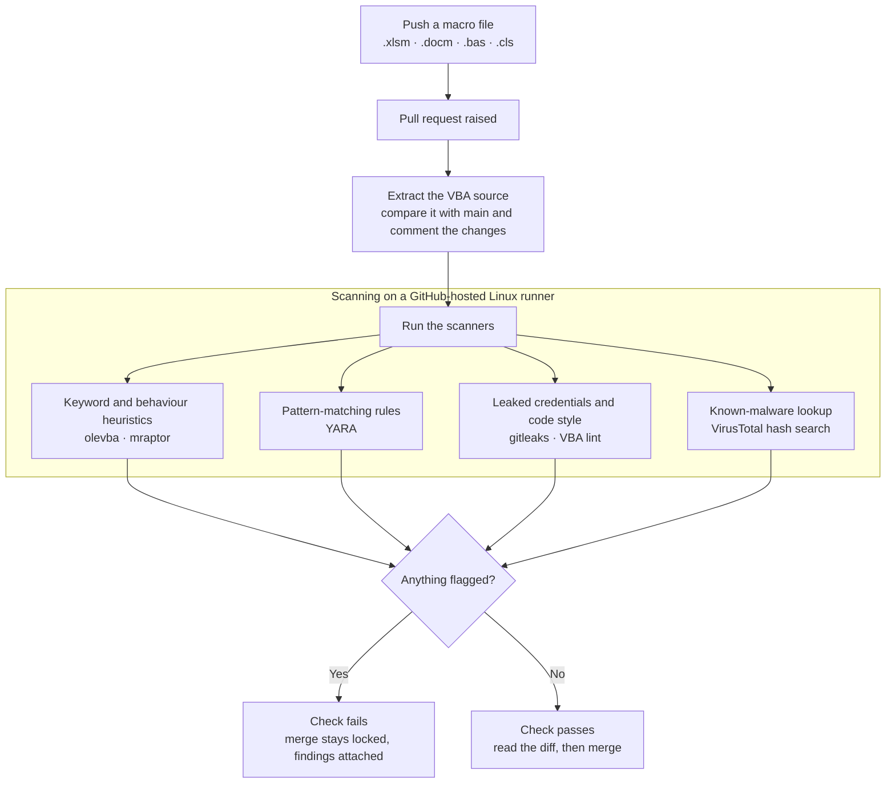

# Office Macro Scanner

**Static analysis for Microsoft Office VBA macros, on every push and pull request.**

Welcome to Office Macro Scanner, the place where Office macros get checked before they ever get a chance to run. Whenever a macro file (`.xlsm`, `.docm` or `.bas`) is pushed to the repository, GitHub Actions unpacks the VBA and fails the check if the code looks malicious. In a pull request, it also posts the readable code diff as a comment. Nothing is ever opened in Office or executed.

---

## Background: why VBA macros?

### What is VBA?

**VBA (Visual Basic for Applications)** is a programming language built into Microsoft Office: Word, Excel, PowerPoint, Outlook and Access. People use it to automate their work, for example formatting reports, copying data between sheets or generating invoices.

A VBA program is called a **macro**. Macros are stored *inside* the document, in a binary file called `vbaProject.bin`. Files that can hold macros have an `m` in the extension: `.xlsm`, `.docm`, `.pptm`, `.dotm`. The older `.xls` and `.doc` formats can hold them too.

```vb
Sub SayHello()
    MsgBox "Hello from a macro"
End Sub
```

### Why does it matter?

A macro runs with the same permissions as the person who opened the document. It can:

- start other programs, including PowerShell and `cmd.exe`
- download files from the internet
- read, write and delete files
- call Windows APIs directly
- run automatically the moment the document opens

That makes a macro document one of the easist ways for an attacker to get code running on someone's computer: send an "invoice" by email and ask the reader to click **Enable Content**. Emotet, Dridex, TrickBot and Qakbot all spread this way, and many ransomware incidents started with a macro. 
- Microsoft has blocked macros in files from the internet by default since 2022, but macros still arrive through shared drives, templates, add-ins and files that have lost their "downloaded from the internet" marker.

### Attack surface

| Entry point | How a macro gets in |
| :--- | :--- |
| Email attachments | `.docm` / `.xlsm` / `.xls` sent as an invoice, CV or delivery note |
| Shared folders and cloud drives | Files copied internally do not carry the internet marker, so Office does not block them |
| Templates and add-ins | `Normal.dotm`, `.xlam` and `.dotm` load every time Office starts, so the macro persists |
| Remote templates | A harmless-looking `.docx` loads a macro-enabled template from a URL |
| Archives and disk images | `.zip`, `.iso` and `.img` files have been used to strip the internet marker |

## [MITRE ATT&CK](https://attack.mitre.org/)

Once the project is complete, these are the MITRE ATT&CK techniques I want the scanner to cover. Static analysis finds *signs* of a technique in the code; it cannot prove what the code does when it runs.

| Tactic | Technique | Name | What the scanner looks for |
| :--- | :--- | :--- | :--- |
| [Execution](https://attack.mitre.org/tactics/TA0002/) | [T1059.005](https://attack.mitre.org/techniques/T1059/005/) | Command and Scripting Interpreter: Visual Basic | Any VBA present, auto-run triggers |
| [Execution](https://attack.mitre.org/tactics/TA0002/) | [T1204.002](https://attack.mitre.org/techniques/T1204/002/) | User Execution: Malicious File | `AutoOpen`, `Document_Open`, `Workbook_Open` |
| [Execution](https://attack.mitre.org/tactics/TA0002/) | [T1059.001](https://attack.mitre.org/techniques/T1059/001/) / [T1059.003](https://attack.mitre.org/techniques/T1059/003/) | PowerShell / Windows Command Shell | `Shell`, `WScript.Shell`, `powershell`, `cmd /c` |
| [Execution](https://attack.mitre.org/tactics/TA0002/) | [T1559.001](https://attack.mitre.org/techniques/T1559/001/) | Inter-Process Communication: COM | `CreateObject`, `GetObject` |
| [Execution](https://attack.mitre.org/tactics/TA0002/) | [T1106](https://attack.mitre.org/techniques/T1106/) | Native API | `Declare PtrSafe Function`, `VirtualAlloc`, `CreateThread` |
| [Persistence](https://attack.mitre.org/tactics/TA0003/) | [T1137.001](https://attack.mitre.org/techniques/T1137/001/) | Office Application Startup: Office Template Macros | Macros in `.dotm` / `.xlam` files |
| [Stealth](https://attack.mitre.org/tactics/TA0005/) | [T1027](https://attack.mitre.org/techniques/T1027/) | Obfuscated Files or Information | `Chr()` chains, Base64, hex, `StrReverse` |
| [Stealth](https://attack.mitre.org/tactics/TA0005/) | [T1564.007](https://attack.mitre.org/techniques/T1564/007/) | Hide Artifacts: VBA Stomping | Source code that does not match the compiled p-code |
| [Credential Access](https://attack.mitre.org/tactics/TA0006/) | [T1552.001](https://attack.mitre.org/techniques/T1552/001/) | Unsecured Credentials: Credentials In Files | Passwords and connection strings in VBA |
| [Command and Control](https://attack.mitre.org/tactics/TA0011/) | [T1105](https://attack.mitre.org/techniques/T1105/) | Ingress Tool Transfer | `URLDownloadToFile`, `XMLHTTP`, URLs |

## Security framework and guidance alignment

How the scanner's checks map to security frameworks and guidance from different countries.

| Country / region | Framework or guidance | Readable source review | Macro scanning | Secrets in macros | Hash reputation | Hardened pipeline |
| :--- | :--- | :--- | :--- | :--- | :--- | :--- |
| Australia | [ASD Essential Eight](https://www.cyber.gov.au/resources-business-and-government/essential-cyber-security/essential-eight) | — | Restrict Office macros: macros checked for malicious code before signing (ML3) | — | Restrict Office macros (supporting) | — |
| Canada | [CCCS ITSAP.00.200 Malicious macros](https://www.cyber.gc.ca/en/guidance/how-protect-your-organization-malicious-macros-itsap00200) | Macros verified by technical authorities | Macros verified by technical authorities | Macros must not contain credentials | — | Least privilege; audit macro developers' actions |
| Germany | [BSI IT-Grundschutz APP.1.1 Office-Produkte (Edition 2023)](https://www.bsi.bund.de/SharedDocs/Downloads/DE/BSI/Grundschutz/IT-GS-Kompendium_Einzel_PDFs_2023/06_APP_Anwendungen/APP_1_1_Office_Produkte_Edition_2023.pdf?__blob=publicationFile&v=4) | APP.1.1.A10 Rules for macro development | APP.1.1.A3 Check external documents for malware | — | Supports APP.1.1.A3 | — |
| United Kingdom | [NCSC Cyber Essentials](https://www.ncsc.gov.uk/cyberessentials/overview), [Software Security Code of Practice](https://www.gov.uk/government/publications/software-security-code-of-practice/software-security-code-of-practice) | Software Security Code of Practice | Cyber Essentials: malware protection | Software Security Code of Practice | Cyber Essentials: malware protection | Software Security Code of Practice |
| United States | [CISA Cybersecurity Performance Goals (CPG 2.0)](https://www.cisa.gov/cybersecurity-performance-goals-2-0-cpg-2-0) | 3.N Change management | 4.A Malicious code detection | — | 4.A Malicious code detection | 3.H Least privilege, 3.N Change management |
| United States | [NIST SSDF (SP 800-218)](https://csrc.nist.gov/pubs/sp/800/218/final) | PW.7 | PW.7, PW.8 | PW.7 | PW.8 | PO.5, PS.1 |
| International | [CIS Controls v8.1](https://www.cisecurity.org/controls/v8-1) | 16 Application software security | 10 Malware defences | 16 Application software security | 10 Malware defences | 16 Application software security |

### Notes on the mapping

- **CCCS ITSAP.00.200** recommends using "organization-developed or signed macros that are verified by technical authorities" and making sure "macros cannot contain any sensitive information like personal credentials".
- **BSI APP.1.1.A3** says documents from external sources must be checked for malware before they are opened. **A10** says binding rules should exist for software developed with Office applications, such as macros.
- **CISA 3.M** (Disable Autorun & Macros By Default) is the CPG goal most directly about macros. It is an endpoint setting, so it sits outside this project's static checks.

----

## Features

| Feature | What it does | Status |
| :--- | :--- | :--- |
| **Readable VBA diffs** | Unpacks `vbaProject.bin` and comments the code changes on the pull request, so binary Office files can be reviewed like normal code | Planned (milestone 1) |


## How it works



Static analysis means **reading a file without running it**. The scanner never opens a document in Office and never runs a macro. Each check adds evidence; none of them decides alone.


## Roadmap

| Milestone | Steps | Adds | Status |
| :--- | :--- | :--- | :--- |
| **1. Unpack, diff and the olevba / mraptor gate** | 0 Workbench · 1 Test macros by hand · 2 Python package and hashing · 3 First workflow · 4 Unpack and diff on the PR · 5 Indicators · 6 Verdict and gate | Readable diffs on pull requests and a blocking `olevba` / `mraptor` check | In progress (step 1) |
| **2. YARA rules** | 7 | Own detection rules with tests | Planned |
| **3. Secret and quality scan** | 8 | gitleaks on unpacked VBA, VBA lint | Planned |
| **4. Reputation, reports and hardening** | 9 VirusTotal · 10 Reports and SARIF · 11 Harden the pipeline | Hash reputation, Security tab alerts, pinned actions, Dependabot, branch rules | Planned |

---

## Repository layout

TBAdded

## Tools and Tech

- [oletools](https://github.com/decalage2/oletools) - oletools is a package of python tools to analyze Microsoft OLE2 files (also called Structured Storage, Compound File Binary Format or Compound Document File Format), such as Microsoft Office 97-2003 documents, MSI files or Outlook messages, mainly for malware analysis, forensics and debugging. It is based on the olefile parser.

- Install oletools
    ```
        uv venv
        source .venv/Scripts/activate
        echo "$VIRTUAL_ENV"
        uv pip install oletools
    ```

## Safety

- Only harmless test files go in this repository. Never commit real malware.
- The scanner reads files; it never opens them in Office or runs them.
- VirusTotal lookups send only the SHA-256 hash, never the file.
- This is a personal learning project, not a production security tool. 


## Glossary

- **ole (Object Linking and Embedding)** : At its core, [OLE](https://www.huntress.com/cybersecurity-101/topic/what-is-object-linking-embedding) enables you to integrate content like text, images, charts, and even spreadsheets from different applications into a single document. Whether you're creating a highly detailed report or designing a presentation, OLE keeps your content interactive and cohesive.
- **Component Object Model** : At the foundation of OLE lies Microsoft’s Component Object Model (COM), which facilitates communication between programs. When you add an OLE object to a document, you preserve its original formatting and functionality. For example, double-clicking an embedded Excel table in Word launches Excel instantly, letting you edit the data.

- **oleid**: to analyze OLE files to detect specific characteristics usually found in malicious files.
- **olevba**: to extract and analyze VBA Macro source code from MS Office documents (OLE and OpenXML).
- **MacroRaptor**: to detect malicious VBA Macros
msodde: to detect and extract DDE/DDEAUTO links from MS Office documents, RTF and CSV
- **pyxswf**: to detect, extract and analyze Flash objects (SWF) that may be embedded in files such as MS Office documents (e.g. Word, Excel) and RTF, which is especially useful for malware analysis.
- **oleobj**: to extract embedded objects from OLE files.
- **rtfobj**: to extract embedded objects from RTF files.