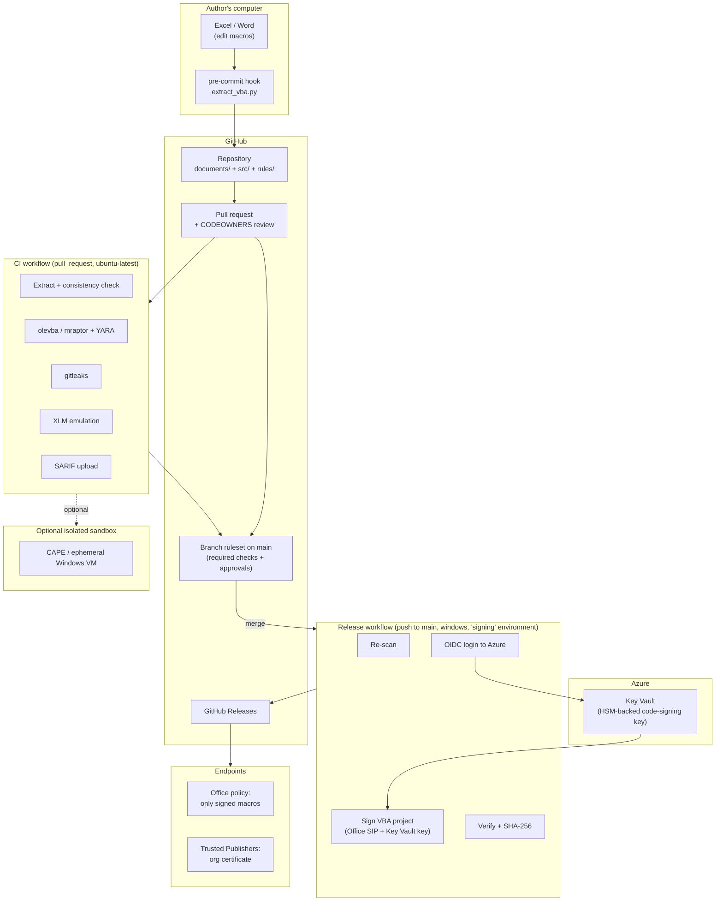

# Design and Build Guide: Office Macro Security Pipeline

This guide turns the [project specification](../office-macro-security-pipeline.md) into something you can build. It covers the architecture, the design decisions behind it, the tools to install, and a phased, step-by-step build with example code.

Read [study-notes.md](study-notes.md) alongside it. Each phase lists the study-notes parts it depends on.

> **Status and caution.** The code and commands below are a starting point, written to be correct in shape but not yet run end to end in this repository. Tool flags, action versions and signing details change; confirm each against the tool's own documentation (`--help`, README) as you go. Steps marked **Verify** are ones where the details are most likely to differ in your environment.

## Contents

1. [Architecture](#1-architecture)
2. [Design principles](#2-design-principles)
3. [Key design decisions](#3-key-design-decisions)
4. [Tech stack and installation](#4-tech-stack-and-installation)
5. [Repository layout](#5-repository-layout)
6. [Build phases](#6-build-phases)
7. [Testing strategy](#7-testing-strategy)
8. [Securing the pipeline itself](#8-securing-the-pipeline-itself)
9. [Operations](#9-operations)
10. [Milestone checklist](#10-milestone-checklist)
11. [Troubleshooting](#11-troubleshooting)

---

## 1. Architecture

### 1.1 Components



### 1.2 Trust boundaries

A trust boundary is a line where data or code passes from something less trusted to something more trusted. Each needs a control.

| # | Boundary | Risk | Control |
| :--- | :--- | :--- | :--- |
| 1 | Author's computer → repository | Malicious or tampered document committed | CI analysis, consistency check, review |
| 2 | PR branch → `main` | Unreviewed code merged | Branch ruleset: required checks + CODEOWNER approval, no bypass |
| 3 | `main` → signing key | Anyone triggering a signature | Protected environment, OIDC restricted to `main`, key non-exportable in Key Vault |
| 4 | Untrusted document → execution | Malware runs on infrastructure | Never execute on CI runners; detonation only in isolated sandbox |
| 5 | Release → endpoint | Unsigned or altered macro runs | Office policy: only Trusted Publisher signed macros |

### 1.3 Data flow summary

1. `documents/*.xlsm` (binary) and `src/<document>/*.bas|.cls|.frm` (text) are committed together.
2. CI regenerates `src/` from `documents/` and fails if they differ.
3. Analysis runs against both the binary and the extracted text.
4. After approval and merge, the release workflow signs the binary's VBA project and publishes it with its hash.

---

## 2. Design principles

A summary of the principles applied here. For explanations, pipeline patterns, threat modelling and coding practices, see [devsecops-principles.md](devsecops-principles.md).

| Principle | How it shows up |
| :--- | :--- |
| **Shift left** | Problems are found at the PR, before anything is signed. |
| **Defence in depth** | Static + emulation + optional detonation + human review + endpoint policy. No single layer is trusted alone. |
| **Text is reviewable truth** | Reviewers approve the plain-text diff. The binary must match it. |
| **Least privilege** | Each workflow declares minimal `permissions:`; signing is isolated in its own workflow and environment. |
| **Separation of duties** | Authors cannot approve their own changes; no human handles the signing key. |
| **Fail closed** | If a tool errors, the check fails. A crashed scanner must never look like a pass. |
| **Evidence by default** | Every run leaves artifacts, SARIF results, approvals and release hashes. |
| **Start simple** | Get static checks and review working first; add emulation, sandboxing and build-from-source later. |

---

## 3. Key design decisions

Recorded in a lightweight "Architecture Decision Record" style: the decision, options, choice and why.

### ADR-1: Source of truth for macro code

| Option | Pros | Cons |
| :--- | :--- | :--- |
| A. Commit binary document **and** extracted text; CI checks they match | Simple; works on Linux runners; no Office needed | Binary could still hide p-code differences (VBA stomping) → mitigated by stomping detection |
| B. Commit text only; build the document from text at release | What runs is exactly what was reviewed | Needs Windows + Office on a self-hosted runner; more complex |

**Choice:** start with **A**, add stomping detection; move to **B** in Phase 9 when the rest works.

### ADR-2: Where analysis runs

**Choice:** GitHub-hosted `ubuntu-latest` for all static and emulation checks. Office is not needed and runners are disposable. Detonation, if used, goes to an isolated sandbox, never the CI runner.

### ADR-3: Dynamic analysis tier

**Choice:** XLM emulation always on; VBA emulation (ViperMonkey) optional because of maintenance and install effort; sandbox detonation optional and only private or self-hosted (public sandboxes may leak business documents).

### ADR-4: Signing key location

| Option | Verdict |
| :--- | :--- |
| `.pfx` file in GitHub Secrets | Rejected: key material can be exfiltrated by a modified workflow. |
| Azure Key Vault, HSM-backed, non-exportable key, OIDC access from `main` only | **Chosen.** Key cannot be copied out; access is short-lived and scoped. |
| Managed signing service (e.g. Microsoft's cloud signing service) | Good alternative; **Verify** that it supports Office VBA projects before choosing. |

### ADR-5: Reporting format

**Choice:** SARIF uploaded to GitHub code scanning, plus a JSON/text artifact. SARIF gives inline PR annotations without extra tooling.

### ADR-6: Framework alignment

**Choice:** framework-neutral, mapped to NIST SSDF, CIS Controls, NIST SP 800-53, ISO/IEC 27001 and ASD Essential Eight (see spec).

---

## 4. Tech stack and installation

### 4.1 Stack overview

| Layer | Tool | Purpose | Where it runs |
| :--- | :--- | :--- | :--- |
| Editing | Microsoft Excel / Word (desktop) | Write and test macros | Author PC |
| Editor | Visual Studio Code | Edit text, YAML, Python | Author PC |
| VBA quality | Rubberduck VBA (VBE add-in) | Export modules, inspections | Author PC |
| Version control | Git, GitHub, GitHub CLI (`gh`) | History, PRs, releases | Author PC, GitHub |
| Language | Python 3.11+ | Runs the analysis tools and scripts | PC, CI |
| Extraction / analysis | oletools (`olevba`, `mraptor`, `msodde`, `oleid`) | Extract VBA, flag indicators | PC, CI |
| Policy rules | YARA (`yara-python`) | Organisation policy patterns | PC, CI |
| Secrets | gitleaks | Hardcoded credentials | PC, CI |
| XLM emulation | XLMMacroDeobfuscator | Excel 4.0 macros | CI |
| VBA emulation (optional) | ViperMonkey | Resolve obfuscated VBA | CI (Docker) |
| Sandbox (optional) | CAPE, or a hosted sandbox API | Detonation | Isolated network |
| Local hooks | pre-commit | Run extraction before each commit | Author PC |
| Local Actions testing (optional) | act | Run workflows locally | Author PC (needs Docker) |
| Containers | Docker Desktop | act, ViperMonkey, gitleaks image | Author PC |
| Signing | Windows SDK `signtool.exe` + Microsoft Office SIP | Sign VBA projects | Windows runner |
| Key storage | Azure Key Vault (Premium for HSM keys), Azure CLI | Hold signing key | Azure |
| Signing client | AzureSignTool (or equivalent) | Sign with a Key Vault key | Windows runner |
| Endpoint policy | Group Policy / Intune + Office ADMX templates | Enforce signed-only macros | IT |

### 4.2 Accounts you need

- **GitHub** account; ideally a GitHub **organisation** (teams make CODEOWNERS and rulesets easier). Private repos on free plans may lack some features (e.g. code scanning for private repos needs GitHub Advanced Security); public repos get them free.
- **Azure** subscription (only from Phase 7, signing).
- **Microsoft 365 / Office** desktop licence for authoring and testing.

### 4.3 Install on Windows (author PC)

Use `winget` (built into Windows 11). Package IDs occasionally change; run `winget search <name>` if one fails.

```powershell
winget install --id Git.Git -e
winget install --id Microsoft.VisualStudioCode -e
winget install --id Python.Python.3.12 -e
winget install --id GitHub.cli -e
winget install --id Docker.DockerDesktop -e     # optional: act, ViperMonkey, gitleaks image
winget install --id Microsoft.AzureCLI -e       # from Phase 7
```

Then, in a new terminal:

```powershell
git config --global user.name  "Your Name"
git config --global user.email "you@example.com"
gh auth login

python -m venv .venv
.\.venv\Scripts\Activate.ps1
python -m pip install --upgrade pip
pip install oletools yara-python XLMMacroDeobfuscator pre-commit
```

**gitleaks:** download the Windows release from <https://github.com/gitleaks/gitleaks/releases>, unzip, and add the folder to `PATH` (or use the Docker image shown in Phase 3).

**Rubberduck VBA:** install from <https://rubberduckvba.com>. It appears in the VBA editor (Alt+F11).

**Windows SDK (`signtool.exe`)**, from Phase 7: install via the Visual Studio Installer ("Windows SDK" component) or `winget search "Windows SDK"`.

**Microsoft Office SIP**, from Phase 7: search Microsoft Download Center for "Microsoft Office Subject Interface Packages for Digitally Signing VBA Projects". Read its readme for prerequisites and registration steps. **Verify** the exact DLL names and steps from that readme.

### 4.4 Check your setup

```powershell
git --version
python --version
olevba --help
mraptor --help
python -c "import yara; print(yara.__version__)"
xlmdeobfuscator --help
gitleaks version
gh --version
```

---

## 5. Repository layout

```text
macro_github/
├── .github/
│   ├── CODEOWNERS
│   └── workflows/
│       ├── macro-ci.yml          # PR analysis
│       └── macro-release.yml     # sign + release after merge
├── documents/                    # macro-enabled Office files (binary)
│   └── Invoice.xlsm
├── src/                          # extracted VBA, one folder per document
│   └── Invoice/
│       ├── Module1.bas
│       └── ThisWorkbook.cls
├── rules/                        # YARA policy rules
│   └── macro_policy.yar
├── tools/
│   ├── extract_vba.py
│   ├── scan.py
│   └── requirements.txt
├── tests/
│   └── samples/                  # benign test documents (see section 7)
├── exceptions.yml                # approved exceptions (Phase 6)
├── .gitattributes
├── .pre-commit-config.yaml
├── docs/
└── office-macro-security-pipeline.md
```

`.gitattributes` keeps line endings stable and marks Office files binary:

```text
*.bas  text eol=crlf
*.cls  text eol=crlf
*.frm  text eol=crlf
*.xlsm binary
*.xlam binary
*.docm binary
*.dotm binary
*.pptm binary
```

> VBA itself uses CRLF line endings. The extraction script below writes LF for clean diffs; if you later import modules back into Office (ADR-1 option B), convert to CRLF. Pick one convention and keep `.gitattributes` consistent with it.

---

## 6. Build phases

Each phase has a **goal**, **prerequisite concepts**, **steps**, and **done when**. Do them in order; each is useful on its own.

### Phase 0: Repository and GitHub basics

**Goal:** a GitHub repository you can push to, with a protected `main`.
**Concepts:** study notes Part 3.

1. Create the repository on GitHub (`gh repo create <org>/macro-pipeline --private` or use the website).
2. Clone it, create the layout from section 5 (empty folders need a `.gitkeep` file).
3. Commit and push.
4. In GitHub: **Settings → Rules → Rulesets → New branch ruleset** targeting `main`:
   - Restrict deletions; block force pushes.
   - Require a pull request before merging, with at least 1 approval.
   - (Required status checks are added in Phase 2, once a check exists.)

**Done when:** a direct `git push` to `main` is rejected and changes go through PRs.

### Phase 1: Extract VBA locally

**Goal:** turn `vbaProject.bin` into reviewable text.
**Concepts:** study notes Parts 2.1–2.3.

`tools/requirements.txt`:

```text
oletools
yara-python
XLMMacroDeobfuscator
```

`tools/extract_vba.py`:

```python
"""Extract VBA source from Office documents into plain-text files.

Usage:
    python tools/extract_vba.py documents src           # write src/
    python tools/extract_vba.py documents src --check   # fail if src/ is out of date
"""
import argparse
import sys
import tempfile
from pathlib import Path

from oletools.olevba import VBA_Parser

OFFICE_EXTENSIONS = {".xlsm", ".xlam", ".xltm", ".docm", ".dotm", ".pptm", ".xls", ".doc", ".ppt"}


def extract_document(doc: Path, out_dir: Path) -> int:
    """Write each VBA module of `doc` to `out_dir`. Returns the module count."""
    parser = VBA_Parser(str(doc))
    count = 0
    try:
        if not parser.detect_vba_macros():
            return 0
        out_dir.mkdir(parents=True, exist_ok=True)
        for _, _, vba_filename, code in parser.extract_macros():
            if isinstance(code, bytes):
                code = code.decode("utf-8", errors="replace")
            normalised = "\n".join(code.splitlines()).rstrip() + "\n"
            (out_dir / vba_filename).write_text(normalised, encoding="utf-8", newline="\n")
            count += 1
    finally:
        parser.close()
    return count


def extract_all(docs_root: Path, out_root: Path) -> None:
    for doc in sorted(docs_root.rglob("*")):
        if doc.suffix.lower() in OFFICE_EXTENSIONS:
            n = extract_document(doc, out_root / doc.stem)
            print(f"{doc}: {n} module(s)")


def tree_contents(root: Path) -> dict:
    if not root.exists():
        return {}
    return {p.relative_to(root).as_posix(): p.read_bytes() for p in root.rglob("*") if p.is_file()}


def main() -> int:
    ap = argparse.ArgumentParser()
    ap.add_argument("documents", type=Path)
    ap.add_argument("src", type=Path)
    ap.add_argument("--check", action="store_true", help="compare instead of writing")
    args = ap.parse_args()

    if not args.check:
        extract_all(args.documents, args.src)
        return 0

    with tempfile.TemporaryDirectory() as tmp:
        fresh_root = Path(tmp)
        extract_all(args.documents, fresh_root)
        committed, fresh = tree_contents(args.src), tree_contents(fresh_root)

    mismatched = sorted(k for k in committed.keys() | fresh.keys() if committed.get(k) != fresh.get(k))
    if mismatched:
        print("Committed source does not match the documents:")
        for name in mismatched:
            print(f"  {name}")
        print("Run: python tools/extract_vba.py documents src  and commit the result.")
        return 1
    print("Committed source matches the documents.")
    return 0


if __name__ == "__main__":
    sys.exit(main())
```

Steps:

1. Create a simple `documents/Invoice.xlsm` with one module (Alt+F11 → Insert → Module).
2. Run `python tools/extract_vba.py documents src` and open `src/Invoice/`.
3. Change the macro in Excel, re-run, and look at `git diff`: you now see code changes line by line.

Automate it with `.pre-commit-config.yaml`:

```yaml
repos:
  - repo: local
    hooks:
      - id: extract-vba
        name: Extract VBA source from Office documents
        entry: python tools/extract_vba.py documents src
        language: system
        pass_filenames: false
        files: ^documents/
```

Run `pre-commit install` once. From then on, committing a changed document regenerates `src/`; if it changed, the commit stops so you can `git add src` and commit again.

**Done when:** editing a macro and committing produces a readable `.bas` diff.

### Phase 2: CI static analysis

**Goal:** every PR is scanned automatically; dangerous findings block the merge.
**Concepts:** study notes Parts 2.5–2.7, 4, 5.2–5.3.

`rules/macro_policy.yar` (a starting policy; tune to your organisation):

```yara
rule Macro_Network_Download
{
    meta:
        description = "Macro can download content from the network"
        severity = "high"
    strings:
        $a = "URLDownloadToFile" nocase
        $b = "MSXML2.XMLHTTP" nocase
        $c = "WinHttp.WinHttpRequest" nocase
        $d = "InternetExplorer.Application" nocase
    condition:
        any of them
}

rule Macro_Win32_API_Declare
{
    meta:
        description = "Macro declares Windows API functions"
        severity = "high"
    strings:
        $declare = /Declare\s+(PtrSafe\s+)?(Function|Sub)/ nocase
    condition:
        $declare
}

rule Macro_Memory_Injection_APIs
{
    meta:
        description = "Memory allocation or thread APIs typical of shellcode loaders"
        severity = "high"
    strings:
        $a = "VirtualAlloc" nocase
        $b = "RtlMoveMemory" nocase
        $c = "CreateThread" nocase
        $d = "WriteProcessMemory" nocase
    condition:
        any of them
}

rule Macro_Runs_Shell
{
    meta:
        description = "Macro launches programs or a shell"
        severity = "medium"
    strings:
        $a = "WScript.Shell" nocase
        $b = "Shell.Application" nocase
        $c = "powershell" nocase
        $d = "cmd.exe" nocase
        $e = /\bShell\s*\(/ nocase
    condition:
        any of them
}
```

`tools/scan.py` (olevba + YARA → SARIF; exits 1 on any error-level finding):

```python
"""Scan Office documents with olevba and YARA, write SARIF, fail on errors.

Usage:
    python tools/scan.py documents rules --sarif results.sarif
"""
import argparse
import json
import sys
from pathlib import Path

import yara
from oletools.olevba import VBA_Parser

OFFICE_EXTENSIONS = {".xlsm", ".xlam", ".xltm", ".docm", ".dotm", ".pptm", ".xls", ".doc", ".ppt"}
YARA_LEVEL = {"high": "error", "medium": "warning", "low": "note"}


def finding(rule_id: str, level: str, message: str, path: Path) -> dict:
    return {
        "ruleId": rule_id,
        "level": level,
        "message": {"text": message},
        "locations": [{"physicalLocation": {"artifactLocation": {"uri": path.as_posix()}}}],
    }


def scan_document(doc: Path, rules: yara.Rules) -> list:
    results = []
    code = ""
    parser = VBA_Parser(str(doc))
    try:
        if parser.detect_vba_macros():
            code = "\n".join(c if isinstance(c, str) else c.decode("utf-8", "replace")
                             for *_, c in parser.extract_macros())
            kinds = set()
            for kind, keyword, description in parser.analyze_macros():
                kinds.add(kind)
                if kind in ("AutoExec", "Suspicious"):
                    results.append(finding(f"olevba/{kind}", "warning", f"{keyword}: {description}", doc))
            if {"AutoExec", "Suspicious"} <= kinds:
                results.append(finding("policy/autoexec-with-suspicious", "error",
                                       "Runs automatically and has a suspicious capability", doc))
            if parser.detect_vba_stomping():
                results.append(finding("olevba/vba-stomping", "error",
                                       "VBA source does not match compiled p-code (possible VBA stomping)", doc))
    finally:
        parser.close()

    seen = set()
    for data in (doc.read_bytes(), code.encode("utf-8")):
        for match in rules.match(data=data):
            if match.rule in seen:
                continue
            seen.add(match.rule)
            severity = match.meta.get("severity", "medium")
            results.append(finding(f"yara/{match.rule}", YARA_LEVEL.get(severity, "warning"),
                                   match.meta.get("description", match.rule), doc))
    return results


def to_sarif(results: list) -> dict:
    rule_ids = sorted({r["ruleId"] for r in results})
    return {
        "version": "2.1.0",
        "$schema": "https://json.schemastore.org/sarif-2.1.0.json",
        "runs": [{
            "tool": {"driver": {"name": "macro-scan", "rules": [{"id": r} for r in rule_ids]}},
            "results": results,
        }],
    }


def main() -> int:
    ap = argparse.ArgumentParser()
    ap.add_argument("documents", type=Path)
    ap.add_argument("rules", type=Path)
    ap.add_argument("--sarif", type=Path, default=Path("results.sarif"))
    args = ap.parse_args()

    rule_files = {p.stem: str(p) for p in args.rules.glob("*.yar")}
    if not rule_files:
        print(f"No YARA rules found in {args.rules}")
        return 2  # fail closed
    rules = yara.compile(filepaths=rule_files)

    results = []
    for doc in sorted(args.documents.rglob("*")):
        if doc.suffix.lower() in OFFICE_EXTENSIONS:
            doc_results = scan_document(doc, rules)
            print(f"{doc}: {len(doc_results)} finding(s)")
            results.extend(doc_results)

    args.sarif.write_text(json.dumps(to_sarif(results), indent=2), encoding="utf-8")
    errors = [r for r in results if r["level"] == "error"]
    for r in results:
        print(f"[{r['level']}] {r['ruleId']}: {r['message']['text']}")
    return 1 if errors else 0


if __name__ == "__main__":
    sys.exit(main())
```

Run it locally first: `python tools/scan.py documents rules --sarif results.sarif`.

`.github/workflows/macro-ci.yml`:

```yaml
name: macro-ci

on:
  pull_request:
    branches: [main]

permissions:
  contents: read

jobs:
  analyse:
    runs-on: ubuntu-latest
    permissions:
      contents: read
      security-events: write   # upload SARIF
    steps:
      - uses: actions/checkout@v4

      - uses: actions/setup-python@v5
        with:
          python-version: "3.12"

      - name: Install analysis tools
        run: pip install -r tools/requirements.txt

      - name: Committed source matches documents
        run: python tools/extract_vba.py documents src --check

      - name: olevba + YARA scan
        run: python tools/scan.py documents rules --sarif results.sarif

      - name: Upload SARIF to code scanning
        if: always()
        uses: github/codeql-action/upload-sarif@v3
        with:
          sarif_file: results.sarif

      - name: Keep reports
        if: always()
        uses: actions/upload-artifact@v4
        with:
          name: macro-scan-results
          path: results.sarif
```

Then add the check to the ruleset: **Settings → Rules → (your ruleset) → Require status checks to pass → add `analyse`**.

**Verify:** action major versions (`@v4`, `@v5`, `@v3`) are current; for production, pin each to a commit SHA. Code scanning on private repositories requires GitHub Advanced Security; without it, drop the SARIF upload step and rely on the artifact and job log.

**Done when:** a PR adding `Workbook_Open` + `Shell` shows a red check and cannot be merged.

### Phase 3: Secret scanning and linting

**Goal:** catch credentials and enforce basic code standards.
**Concepts:** study notes Part 5.4.

Add to `macro-ci.yml` after the scan step:

```yaml
      - name: Secret scan (gitleaks)
        run: |
          docker run --rm -v "${{ github.workspace }}:/repo" zricethezav/gitleaks:latest \
            dir /repo/src --redact --verbose
```

- **Verify:** recent gitleaks versions use `gitleaks dir <path>`; older ones use `gitleaks detect --no-git --source <path>`. Pin the image to a specific version once it works.
- Add a `.gitleaks.toml` later for organisation-specific patterns (internal hostnames, share paths).

Simple lint as a script step (extend as needed):

```yaml
      - name: Require Option Explicit
        run: |
          missing=$(grep -L -i "^Option Explicit" $(find src -name '*.bas' -o -name '*.cls') || true)
          if [ -n "$missing" ]; then echo "Missing Option Explicit:"; echo "$missing"; exit 1; fi
```

Rubberduck inspections run inside the VBA editor on the author's PC; treat them as a local quality aid rather than a CI gate.

**Done when:** a module containing a fake key like `password = "Sup3rSecret!"` or missing `Option Explicit` fails the PR.

### Phase 4: "Somewhat dynamic" analysis

**Goal:** resolve obfuscation without running Office.
**Concepts:** study notes Parts 2.4, 2.7, 5.5–5.6.

XLM emulation step:

```yaml
      - name: XLM (Excel 4.0) emulation
        run: |
          for f in documents/*.xls documents/*.xlsm; do
            [ -e "$f" ] || continue
            echo "== $f"
            xlmdeobfuscator --file "$f" --no-interactive --output-level 1 || echo "no XLM or emulation failed for $f"
          done
```

**Verify:** flag names with `xlmdeobfuscator --help`. Decide your policy: the simplest rule is "**any** XLM macro in a document fails the build", since legitimate new XLM is rare. Implement that in `scan.py` by checking for macro sheets, or by failing when the emulator finds formulas.

ViperMonkey (optional): run its Docker image against each document and save the output as an artifact. Treat its output as information for reviewers first; turn it into a gate only after you see stable results.

Sandbox detonation (optional, later):

- **Never** run this on GitHub-hosted runners.
- Use a private CAPE instance or a hosted sandbox with a private tier. Submit via its REST API from a job that has only the API token, poll for the report, and fail the job if it shows child processes, network connections or file writes you have not approved.
- Run it on PRs that change `documents/`, or nightly, since detonation is slow.

**Done when:** XLM is detected and reported on every PR; you have a written decision on whether VBA emulation and sandboxing are in scope.

### Phase 5: Human review gate

**Goal:** no change merges without the right people approving it.
**Concepts:** study notes Parts 3.2, 5.7.

`.github/CODEOWNERS`:

```text
# Macro code: reviewed by the macro reviewers team
/src/         @your-org/macro-reviewers
/documents/   @your-org/macro-reviewers

# Pipeline and policy: security team only
/.github/     @your-org/security
/rules/       @your-org/security
/tools/       @your-org/security
/exceptions.yml @your-org/security
```

In the ruleset for `main`, enable **Require review from Code Owners**, **Dismiss stale approvals when new commits are pushed**, and make sure no one (including admins) can bypass.

Add a PR template `.github/pull_request_template.md`:

```markdown
## What does this macro change do?

## Why is it needed? (business reason)

## Flagged capabilities and justification
<!-- e.g. "Writes a CSV to the user's Documents folder for the monthly export" -->

- [ ] I have tested this in Office
- [ ] Source in src/ is regenerated and committed
```

**Done when:** a PR with green checks still cannot merge until a CODEOWNER approves.

### Phase 6: Exceptions process

**Goal:** legitimate macros that trip a rule can be approved in a controlled way.

`exceptions.yml`:

```yaml
- document: documents/Invoice.xlsm
  rule: yara/Macro_Runs_Shell
  reason: Opens the exported CSV in Notepad for the user
  approved_by: security-team-member
  expires: 2027-06-30
```

Extend `scan.py` to load this file and downgrade matching findings from `error` to `note`, and to **fail** on expired entries. Because `exceptions.yml` is owned by `@your-org/security` in CODEOWNERS, only security can approve new exceptions.

**Done when:** an approved exception lets a PR pass, and an expired one makes it fail again.

### Phase 7: Signing infrastructure

**Goal:** a code-signing key that the release workflow can use but no person can copy.
**Concepts:** study notes Part 6, Part 4.5.

Step 7.1, learn with a test certificate first (on your own PC, never for production):

```powershell
$cert = New-SelfSignedCertificate -Type CodeSigningCert `
    -Subject "CN=Macro Pipeline TEST" -CertStoreLocation Cert:\CurrentUser\My
```

Sign a test document manually in the VBA editor (**Tools → Digital Signature**), trust the test certificate on your PC, set Excel to "Disable all except digitally signed macros", and confirm the macro runs; edit the code and confirm the signature is removed or invalid.

Step 7.2, install the Office SIP and sign from the command line (on a Windows test machine):

1. Install the Office SIP following its readme (registers the SIP DLLs, typically with `regsvr32`).
2. Export the test certificate to a `.pfx` and sign:

```powershell
signtool sign /fd SHA256 /f test.pfx /p <password> `
    /tr http://timestamp.digicert.com /td SHA256 documents\Invoice.xlsm
```

3. Verify using the method in the SIP readme (it includes a verification script). **Verify** this step carefully; if `signtool` signs without the SIP registered, it is not signing the VBA project.

Step 7.3, production key in Azure Key Vault:

1. Obtain a code-signing certificate: from your internal CA (if all endpoints are domain-managed) or a public CA. Public CAs now require the key to be generated in an HSM, which Key Vault Premium provides.
2. Create a Key Vault (**Premium** tier for HSM-backed keys), generate the certificate request inside Key Vault so the key is **non-exportable**, and merge the issued certificate.
3. Create a Microsoft Entra ID app registration for GitHub, with a **federated credential** for:
   `repo:<org>/<repo>:environment:signing`
   This means only jobs running in the `signing` environment of this repo can obtain a token.
4. Grant that app only the Key Vault permissions needed to sign (e.g. the "Key Vault Crypto User" and "Key Vault Certificate User" roles on that vault).
5. In GitHub: **Settings → Environments → New environment `signing`**:
   - Deployment branches: `main` only.
   - Required reviewers: a release approver.
   - Environment variables: `AZURE_CLIENT_ID`, `AZURE_TENANT_ID`, `AZURE_SUBSCRIPTION_ID`, `KEY_VAULT_URL`, `CERT_NAME` (IDs, not secrets).

**Done when:** you have a Key Vault certificate with a non-exportable key, and an environment restricted to `main`.

### Phase 8: Release workflow

**Goal:** after merge, sign and publish automatically.
**Concepts:** study notes Parts 4.5, 6.

`.github/workflows/macro-release.yml` (a sketch; **Verify** the signing tool's flags and Office SIP behaviour on a test runner first):

```yaml
name: macro-release

on:
  push:
    branches: [main]
    paths: ["documents/**"]

permissions:
  contents: read

jobs:
  rescan:
    runs-on: ubuntu-latest
    steps:
      - uses: actions/checkout@v4
      - uses: actions/setup-python@v5
        with:
          python-version: "3.12"
      - run: pip install -r tools/requirements.txt
      - run: python tools/extract_vba.py documents src --check
      - run: python tools/scan.py documents rules --sarif results.sarif

  sign-and-release:
    needs: rescan
    runs-on: windows-latest
    environment: signing
    permissions:
      contents: write      # create the release
      id-token: write      # OIDC to Azure
    steps:
      - uses: actions/checkout@v4

      - name: Azure login (OIDC, no stored secret)
        uses: azure/login@v2
        with:
          client-id: ${{ vars.AZURE_CLIENT_ID }}
          tenant-id: ${{ vars.AZURE_TENANT_ID }}
          subscription-id: ${{ vars.AZURE_SUBSCRIPTION_ID }}

      - name: Install Office SIP
        shell: pwsh
        run: |
          # Download the Office SIP package from a location you control,
          # check its SHA-256 against a pinned value, then register it as its readme describes.
          Write-Host "TODO: install and register Office SIP"

      - name: Sign VBA projects
        shell: pwsh
        run: |
          dotnet tool install --global AzureSignTool
          $token = az account get-access-token --resource https://vault.azure.net --query accessToken -o tsv
          New-Item -ItemType Directory -Force release | Out-Null
          Get-ChildItem documents -Include *.xlsm,*.docm,*.xlam,*.dotm -Recurse | ForEach-Object {
            Copy-Item $_.FullName release\
          }
          Get-ChildItem release\* | ForEach-Object {
            AzureSignTool sign `
              --azure-key-vault-url "${{ vars.KEY_VAULT_URL }}" `
              --azure-key-vault-certificate "${{ vars.CERT_NAME }}" `
              --azure-key-vault-accesstoken $token `
              --file-digest sha256 `
              --timestamp-rfc3161 http://timestamp.digicert.com `
              --timestamp-digest sha256 `
              $_.FullName
            if ($LASTEXITCODE -ne 0) { throw "Signing failed for $($_.Name)" }
          }

      - name: Verify signatures
        shell: pwsh
        run: |
          # Use the verification method from the Office SIP readme. Fail the job if any file is unsigned.
          Write-Host "TODO: verify each file in release\"

      - name: Hashes
        shell: pwsh
        run: |
          Get-ChildItem release\* | Get-FileHash -Algorithm SHA256 |
            ForEach-Object { "$($_.Hash.ToLower())  $(Split-Path $_.Path -Leaf)" } |
            Set-Content release\SHA256SUMS.txt

      - name: Publish GitHub Release
        shell: pwsh
        env:
          GH_TOKEN: ${{ github.token }}
        run: |
          gh release create "v${{ github.run_number }}" release\* `
            --title "Signed macros v${{ github.run_number }}" `
            --notes "Built from ${{ github.sha }}. Verify files against SHA256SUMS.txt."
```

Notes:

- Whether AzureSignTool (or Microsoft's cloud signing service with `signtool /dlib`) signs Office VBA projects through the Office SIP must be **verified** in your environment. If it does not, fall back to a self-hosted Windows runner with an HSM-backed certificate and `signtool` with the SIP.
- GitHub-hosted Windows runners do not have Office. Signing through the SIP may or may not require Office components; test it.
- Consider adding **build provenance attestations** (GitHub's `actions/attest-build-provenance`) for SLSA-style evidence.

**Done when:** merging a change produces a release with signed files and `SHA256SUMS.txt`, and the signed file runs on a test PC configured for signed-only macros.

### Phase 9: Build from source (optional, advanced)

**Goal:** what you sign is built from the reviewed text, closing the VBA-stomping gap completely (ADR-1 option B).

- Requires a **self-hosted Windows runner** with Office installed, in an isolated network segment, used only for this job.
- Enable "Trust access to the VBA project object model" **only** on that runner.
- A PowerShell script opens a clean template via COM, removes existing modules, imports each `.bas`/`.cls`/`.frm` from `src/`, saves the document, and closes Office. Then the signing steps from Phase 8 run.
- Compare: extract the built document again and diff it against `src/` as a final check.

**Done when:** the release job ignores the committed binary and produces the document from `src/`.

### Phase 10: Endpoint enforcement

**Goal:** the pipeline actually matters on users' computers.
**Concepts:** study notes Part 2.8, 6.3.

Work with IT. Using Group Policy (with the Microsoft 365 Apps ADMX templates) or Intune:

1. **Deploy the signing certificate** to the Trusted Publishers store:
   Computer Configuration → Windows Settings → Security Settings → Public Key Policies → Trusted Publishers.
2. For each Office application (Excel, Word, PowerPoint…), under *Trust Center*:
   - **VBA Macro Notification Settings:** "Disable all except digitally signed macros".
   - **Block macros from running in Office files from the internet:** Enabled.
   - **Require that application add-ins are signed by Trusted Publisher:** Enabled.
   - Disable or tightly control **Trusted Locations**.
3. Pilot with one team, collect unsigned macros that break, bring them through the pipeline, then expand.

**Verify:** exact policy names against the current ADMX templates and the CIS Microsoft Office Benchmark.

**Done when:** on a managed test PC, a signed release runs and an unsigned copy is blocked without a prompt the user can click through.

---

## 7. Testing strategy

### 7.1 Benign test documents

Build your own test files. They should **look** suspicious to scanners while doing nothing harmful.

| Test file | Content | Expected result |
| :--- | :--- | :--- |
| `clean.xlsm` | `Option Explicit` + a `MsgBox` sub | Pass |
| `autoexec-only.xlsm` | `Workbook_Open` that sets a cell value | Warning, pass |
| `autoexec-shell.xlsm` | `Workbook_Open` calling `Shell "notepad.exe"` | Error, fail |
| `declare-api.xlsm` | `Declare PtrSafe Function GetTickCount Lib "kernel32" () As Long` | YARA error, fail |
| `download-string.docm` | A string containing `URLDownloadToFile` (never called) | YARA error, fail |
| `secret.xlsm` | `Const ApiKey = "AKIA...EXAMPLE"` style fake key | gitleaks fail |
| `no-option-explicit.xlsm` | Module without `Option Explicit` | Lint fail |
| `tampered.xlsm` | Edit the document but do not regenerate `src/` | Consistency check fail |

Store them in `tests/samples/` and add a CI job that runs `scan.py` on each and asserts the expected outcome.

### 7.2 Real malware samples

Only if you need to test detection against real-world samples:

- Use an **isolated lab VM** with no access to your network, snapshots, and no shared folders.
- Get samples from research repositories (e.g. MalwareBazaar) under their terms; keep them in password-protected archives.
- **Never** commit live malware to this repository or run it on CI runners.

### 7.3 Pipeline tests

- Open a PR that edits a rule in `rules/` without security approval → must be blocked by CODEOWNERS.
- Try to run the release workflow from a non-`main` branch → environment must refuse.
- Remove the signing role from the app registration → signing must fail closed.

---

## 8. Securing the pipeline itself

The pipeline holds the power to make code trusted on every endpoint, so it is a target.

| Threat | Mitigation |
| :--- | :--- |
| Attacker edits a workflow to skip checks | CODEOWNERS on `/.github/`, ruleset requires security approval, no bypass. |
| Attacker edits YARA rules or `exceptions.yml` | Same: security-owned paths. |
| Compromised third-party action | Pin actions to commit SHAs; review updates (Dependabot can propose them). |
| Signing key theft | Non-exportable HSM key; OIDC scoped to `environment:signing`; no `.pfx` anywhere. |
| Workflow injection via PR titles or branch names | Never interpolate `${{ github.event.* }}` text directly into `run:`; use `env:`. |
| Forked PR runs code with secrets | Use `pull_request` (not `pull_request_target`) for analysis; secrets are not exposed. |
| Insider approves own malicious change | Requires a different CODEOWNER; dismiss stale approvals; audit log review. |
| Scanner crash treated as pass | Scripts fail closed (non-zero exit on errors or missing rules). |

---

## 9. Operations

| Task | Frequency | Owner |
| :--- | :--- | :--- |
| Update YARA rules from new threat intel | Monthly or after notable campaigns | Security |
| Update tool versions (oletools, actions, gitleaks) | Monthly, via PRs | Security |
| Review `exceptions.yml`; remove expired entries | Monthly | Security |
| Review GitHub and Azure Key Vault audit logs | Monthly | Security |
| Rotate / renew the signing certificate | Before expiry (plan re-signing of all releases) | Security + IT |
| Respond to a flagged or suspicious release | As needed: revoke trust, pull release, investigate history | Security |

If the signing key is ever suspected compromised: remove the certificate from Trusted Publishers on endpoints, revoke it with the CA, issue a new one, and re-sign every approved document.

---

## 10. Milestone checklist

- [ ] Phase 0: Repository created, `main` protected
- [ ] Phase 1: VBA extraction script and pre-commit hook working
- [ ] Phase 2: CI scan with olevba + YARA, SARIF, required status check
- [ ] Phase 3: gitleaks and `Option Explicit` lint in CI
- [ ] Phase 4: XLM emulation; decision recorded on ViperMonkey and sandboxing
- [ ] Phase 5: CODEOWNERS, PR template, code-owner review required
- [ ] Phase 6: Exceptions file with expiry enforced
- [ ] Phase 7: Test signing understood; Key Vault certificate and `signing` environment ready
- [ ] Phase 8: Release workflow signs, verifies, hashes and publishes
- [ ] Phase 9 (optional): Build from source on isolated self-hosted runner
- [ ] Phase 10: Endpoint policy piloted and rolled out
- [ ] Test corpus in `tests/samples/` with expected results in CI

---

## 11. Troubleshooting

| Symptom | Likely cause | Fix |
| :--- | :--- | :--- |
| `olevba` finds no macros in a `.xlsx` | `.xlsx` cannot hold VBA | Save as `.xlsm`. |
| `--check` fails on every run | Line-ending or encoding differences | Make `.gitattributes` and the script agree; re-extract and commit. |
| `yara-python` fails to install | No prebuilt wheel for your Python version | Use a supported Python version (e.g. 3.12) or install build tools. |
| SARIF upload fails | Code scanning not enabled for this repo | Enable it, or remove the step for private repos without Advanced Security. |
| Required check never appears in ruleset list | Check has never run | Run the workflow once on a PR, then add it. |
| `azure/login` fails with "no matching federated identity" | Federated credential subject does not match | Subject must be exactly `repo:<org>/<repo>:environment:signing`. |
| Signed macro still blocked on endpoint | Certificate not in Trusted Publishers, or chain/timestamp issue | Check the certificate store and the signature details in the VBA editor. |
| Signature disappears after editing | Expected: changing code invalidates it | Re-run the pipeline. |
