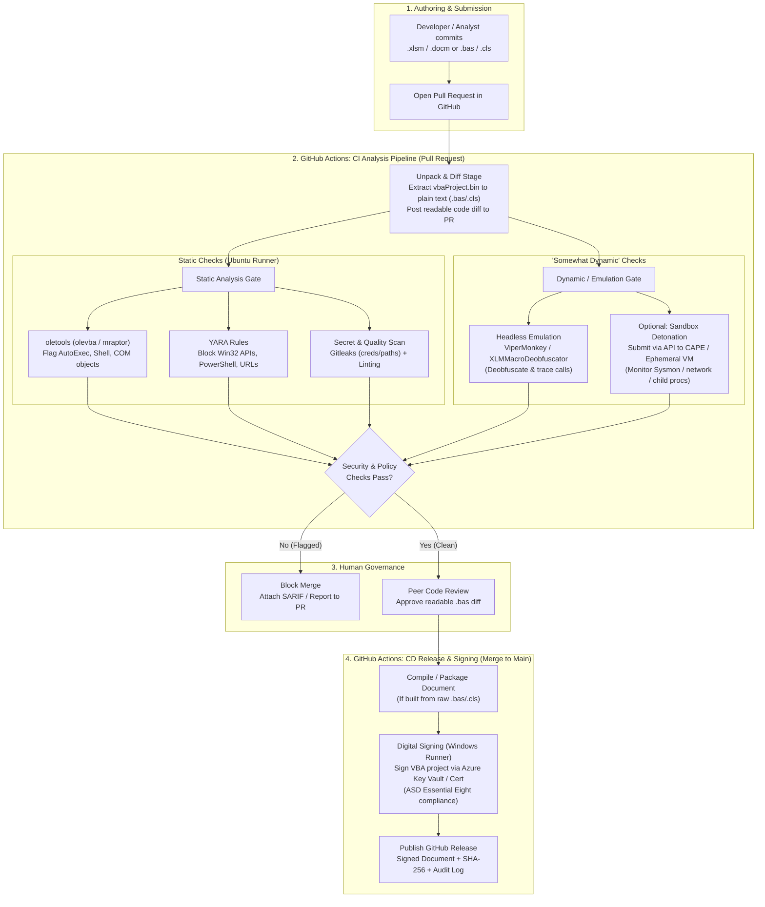

# Proposed Macro Governance & Analysis Pipeline (GitHub & GitHub Actions)

## Overview

This document outlines a high-level architecture for managing, analysing, and signing Microsoft Office macros (VBA and Excel 4.0/XLM) using GitHub and GitHub Actions. It combines static code analysis, headless emulation ("somewhat dynamic" analysis), peer review of extracted source code, and automated digital signing aligned with the **ASD Essential Eight**.

---

## High-Level Architecture

Flagged builds are blocked at the PR. Only clean, peer-approved code reaches signing and release.

## Stage-by-Stage Breakdown

| Stage | Purpose | Key Tools | Output / Gate |
| :--- | :--- | :--- | :--- |
| **1. Unpack & Normalise** | Make binary macros (`vbaProject.bin`) human-readable in Git so reviewers can inspect exact line changes. | `oletools` (`olevba`), `vbaProject` extractor | Plain-text `.bas`/`.cls`/`.frm` files committed or posted as a PR comment/artifact. |
| **2. Static Analysis** | Catch known dangerous capabilities, hardcoded secrets, and policy violations immediately. | `olevba`, `mraptor`, **YARA**, `gitleaks`, Rubberduck VBA | Pass/Fail status check; flags `WScript.Shell`, `Shell()`, Win32 `Declare` statements, DDE, and credentials. |
| **3. Somewhat Dynamic Analysis** | Resolve runtime string obfuscation (`Chr()`, `Environ()`) and trace execution behaviour without manual testing. | **ViperMonkey**, **XLMMacroDeobfuscator**, or Sandbox API (CAPE/Tria.ge) | Execution trace showing resolved strings, file writes, or network/process calls. |
| **4. Peer Review (PR Gate)** | Ensure a second pair of eyes verifies business logic and approves any justified exceptions. | GitHub Branch Protection + `CODEOWNERS` | Mandatory approval from Security/Engineering before merge is unlocked. |
| **5. Signing & Release** | Guarantee integrity and satisfy endpoint macro security controls (ASD Essential Eight). | `signtool.exe` + MS Office SIP + Azure Key Vault | Digitally signed `.xlsm`/`.docm` published to GitHub Releases with an immutable audit trail. |

---

## Detailed Capabilities

### 1. Repository Structure: Source vs Binary

Office documents (`.xlsm`, `.docm`, `.dotm`) are ZIP containers storing macros inside a compiled binary (`vbaProject.bin`). Because Git cannot natively diff `vbaProject.bin` for code review:

- **Extract source automatically:** Use a pre-commit hook or GitHub Action (`olevba`) to unpack VBA source (`.bas`, `.cls`, `.frm`) into the PR for human review, and verify the binary matches the unpacked source.
- **Build on release:** Optionally use a Windows runner to compile the `.bas`/`.cls` files into the template document during the CD phase prior to signing.

### 2. Static Analysis in GitHub Actions

Runs on standard `ubuntu-latest` or `windows-latest` runners on every Pull Request:

- **Capability & Indicator Scanning (`oletools`):**
  - `olevba` and `mraptor` detect auto-execution triggers (`AutoOpen`, `Document_Open`), suspicious COM objects (`WScript.Shell`, `Scripting.FileSystemObject`), PowerShell/cmd execution, Base64/hex obfuscation, and DDE links.
  - `msodde` and `pyxswf` check for DDE injection or embedded Flash/OLE objects.
- **YARA Policy Enforcement:**
  - Run custom YARA rules against both the container document and extracted streams to enforce organisational policy (e.g. blocking `URLDownloadToFile`, Win32 API declarations like `VirtualAlloc`, or raw socket calls).
- **Secret Scanning & Linting:**
  - Scan extracted `.bas` files with `gitleaks` or GitHub Secret Scanning to catch hardcoded credentials, API keys, or internal file share paths.
  - Use Rubberduck VBA or custom regex checks to enforce coding standards (`Option Explicit`, error handling).

### 3. "Somewhat Dynamic" Analysis Options

Because GitHub-hosted runners do not include licensed Microsoft Office installations and GUI automation is brittle, dynamic analysis can be tiered:

- **Option A: VBA/XLM Emulation (Headless Linux/Windows Runners)**
  - **ViperMonkey:** Parses and symbolically executes VBA code without Office installed. Deobfuscates strings, traces execution paths on `AutoOpen`, and logs called APIs/shell commands.
  - **XLMMacroDeobfuscator:** Emulates Excel 4.0 (XLM) macros to resolve obfuscated formula chains.
- **Option B: Sandbox API Integration (Cloud Runners)**
  - Submit the compiled `.docm`/`.xlsm` via API from GitHub Actions to an external or self-hosted detonation sandbox (e.g. **CAPE Sandbox**, **Cuckoo**, **Tria.ge**, or **Joe Sandbox**).
  - Fail the PR if the behavioural report detects unexpected child processes, network connections, or file system modifications.
- **Option C: Self-Hosted Ephemeral Windows Runner**
  - Use an isolated, ephemeral VM with Microsoft Office and Sysmon/ETW logging enabled.
  - Launch the document headlessly via PowerShell COM (`New-Object -ComObject Word.Application`), capture ETW/Sysmon telemetry, and tear down the VM after execution.

---

## Alignment with ASD Essential Eight

- **Control Requirement (Maturity Level 2 & 3):** Only signed macros from trusted publishers are allowed to execute; macros must be vetted for malicious indicators before signing.
- **Pipeline Enforcement:** Developers never hold the code-signing certificate directly. The signing certificate resides in Azure Key Vault / GitHub Secrets and is **only** applied by the CD workflow *after* automated static/dynamic checks pass and a designated `CODEOWNER` approves the plain-text code diff.

---

## Implementation Notes

This README transcribes the proposed design shown in the supplied screenshots; it is **a proposal, not a deployed or verified pipeline**. Before implementation:

- Verify the precise ASD Essential Eight requirements and maturity-level applicability against current ASD guidance.
- Confirm the Office VBA-project signing mechanism and certificate/key integration: `signtool.exe` alone should not be assumed to sign VBA projects correctly.
- Keep signing private keys in a controlled key service rather than storing private-key material in GitHub Secrets.
- Run untrusted documents only in an isolated detonation environment, never on a general-purpose CI runner; Office COM automation does not itself guarantee macro execution.
- Treat sandbox results and source-to-binary correspondence as validation gates requiring explicit implementation and testing.
