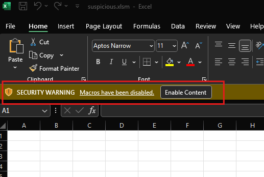
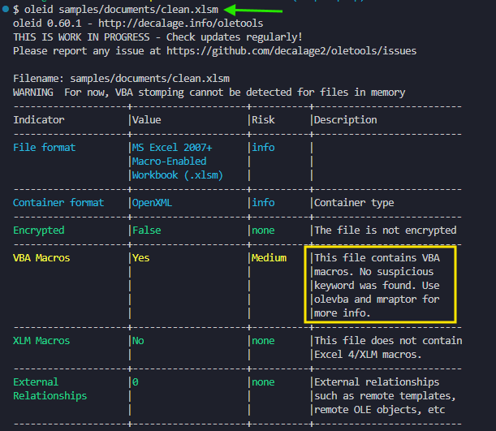
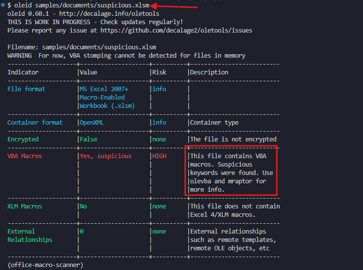
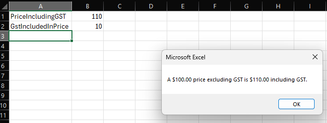

# Progress Notes

A dated log of what I built, what I learned

## Sun 25 Oct 2026
- Main branch is not protected.

### **1. Created malicious looking VBA**
- Created [suspicious.xlsm](../../samples/documents/suspicious.xlsm) and added suspicious looking vba code. But never opens notepad.exe. Closed xlsm file and reopend.
- 

### **2.Tested that .xlsm is a zip file.** 
- `py scripts/inspect_ooxml.py samples/documents/clean.xlsm `

| Extension | Meaning |
|---|---|
| `.docx` / `.docm` | Word document, x refers to XML-based format/ Word document with macros |
| `.xlsx` / `.xlsm` | Excel workbook / Excel workbook with macros |
| `.pptx` / `.pptm` | PowerPoint presentation / PowerPoint presentation with macros |

### **3. Hash the files and tested**
- Original Version : `py scripts/hash_files.py samples/documents/clean.xlsm`

```
samples\documents\clean.xlsm
  MD5     18DF4B9BED807028B246FEAC19FE9C73
  SHA1    347836B0767E2CDE193A510E28BBFED702D9DF68
  SHA256  ACA07589C8399186D364330575E8C8D1062A776E10DAF156909496BE58B7BF28
```

- MOdified Version : `py scripts/hash_files.py samples/documents/change_documents/clean.xlsm`

```
samples\documents\change_documents\clean.xlsm
  MD5     722073CB881747EA66607031D87E1BCA
  SHA1    0B3C8310A084AF457B323181FC5243D12B934829
  SHA256  5F4E8FE959B8BE42043AE33BF9CC02A23731D41731ABE5BAC17147E0CC848669
```

### **4. [oletools](https://github.com/decalage2/oletools)**

```
uv pip install oletools

# oleid: to analyze OLE files to detect specific characteristics usually found in malicious files.
```
#### 4.1. Check what kinf of file, does it have macro? Is it encrypted?

- oleid clean file `oleid samples/documents/clean.xlsm`

- 

- oleid suspicious file (nodepad.xex and some obusfaced text)

- 

#### 4.2. List the streams inside vbaProject.bin

- oledir: to display all the directory entries of an OLE file, including free and orphaned entries.
- `pwsh .\scripts\inspect_vbaproject.ps1 samples\documents\suspicious.xlsm`
- vbaProject.bin has VBA code written.

```
oledir 0.54 - http://decalage.info/python/oletools
OLE directory entries in file 
...Local\Temp\macro-look\suspicious\extracted\xl\vbaProject.bin:
----+------+-------+----------------------+-----+-----+-----+--------+------
id  |Status|Type   |Name                  |Left |Right|Child|1st Sect|Size  
----+------+-------+----------------------+-----+-----+-----+--------+------
0   |<Used>|Root   |Root Entry            |-    |-    |8    |3       |9472  
1   |<Used>|Storage|VBA                   |-    |-    |3    |0       |0     
2   |<Used>|Stream |ModLooksBad_OpenNotepa|5    |-    |-    |0       |3234  
    |      |       |d                     |     |     |     |        |      
3   |<Used>|Stream |ThisWorkbook          |4    |2    |-    |33      |999   
4   |<Used>|Stream |Sheet1                |6    |-    |-    |43      |991   
5   |<Used>|Stream |_VBA_PROJECT          |-    |-    |-    |53      |2795  
6   |<Used>|Stream |dir                   |-    |-    |-    |7F      |612   
7   |<Used>|Stream |PROJECTwm             |-    |-    |-    |89      |134   
8   |<Used>|Stream |PROJECT               |1    |7    |-    |8C      |505   
9   |unused|Empty  |                      |-    |-    |-    |0       |0     
10  |unused|Empty  |                      |-    |-    |-    |0       |0     
11  |unused|Empty  |                      |-    |-    |-    |0       |0     
----+----------------------------+------+--------------------------------------
id  |Name                        |Size  |CLSID                                 
----+----------------------------+------+--------------------------------------
0   |Root Entry                  |-     |                                      
8   |PROJECT                     |505   |                                      
7   |PROJECTwm                   |134   |                                      
1   |VBA                         |-     |                                      
2   |  ModLooksBad_OpenNotepad   |3234  |                                      
4   |  Sheet1                    |991   |                                      
3   |  ThisWorkbook              |999   |                                      
5   |  _VBA_PROJECT              |2795  |                                      
6   |  dir                       |612   |     
```

#### 4.3 Extract the code

- olevba: to extract and analyze VBA Macro source code from MS Office documents (OLE and OpenXML).

- `py .\scripts_experiments\run_olevba.py samples\documents `
- OUTPUT : D:\repos\office-macro-scanner\output
- Usage and options
  - https://github.com/decalage2/oletools/wiki/olevba

```
Options 
  -a, --analysis        display only analysis results, not the macro source
                          code
  -c, --code            display only VBA source code, do not analyze it
  --decode              display all the obfuscated strings with their decoded
                          content (Hex, Base64, StrReverse, Dridex, VBA).
Output mode
    -j, --json          json mode, detailed in json format (never default)
```

### GitHub Actions and features to learn

Everything this project uses, in the order the steps need it. Tick each one off once I've used it for real.

**Git and GitHub basics (steps 0–1)**
- [ ] Branches, commits, push, pull requests, merge (merge commit vs squash)
- [ ] `gh` CLI: `gh pr create`, `gh pr view`, `gh run list`, `gh run watch`
- [ ] Repository settings: default branch, auto-delete head branches, visibility (public vs private)
- [ ] `.gitignore` and `.gitattributes` (line endings, binary files such as `.xlsm`)

**Workflow fundamentals (steps 1–3)**
- [ ] Workflow files in `.github/workflows/`, YAML syntax
- [ ] Triggers (`on:`): `push`, `pull_request`, `workflow_dispatch`, `schedule` (cron)
- [ ] Path and branch filters: `paths:`, `branches:`
- [ ] Jobs, steps, `runs-on: ubuntu-latest`, GitHub-hosted runners
- [ ] `uses:` (actions) vs `run:` (shell commands), `with:` inputs
- [ ] `actions/checkout`: `persist-credentials: false`, `fetch-depth`, `sparse-checkout`, `ref`, `path`
- [ ] Setting up tools: `astral-sh/setup-uv` (with caching), installing CLIs in a step
- [ ] Exit codes: a non-zero exit fails the step, the job and the check
- [ ] Reading logs, re-running failed jobs, the Actions tab

**Job design (steps 3–6)**
- [ ] Multiple jobs and `needs:` (job dependencies)
- [ ] `timeout-minutes`, `concurrency` with `cancel-in-progress`
- [ ] Conditionals: `if:`, `always()`, `success()`, `failure()`, `github.event_name`
- [ ] Contexts and expressions: `${{ github.* }}`, `github.base_ref`, `github.sha`, `runner.temp`
- [ ] Environment variables: `env:` at workflow, job and step level
- [ ] Special files: `$GITHUB_OUTPUT` (step outputs), `$GITHUB_ENV`, `$GITHUB_PATH`, `$GITHUB_STEP_SUMMARY` (job summary)
- [ ] Job and step `outputs:` passed between jobs
- [ ] Artifacts: `actions/upload-artifact` / `download-artifact`, `retention-days`
- [ ] Workflow commands and annotations: `::error file=...::`, `::warning::`, `::group::`

**Pull request integration (steps 4–6)**
- [ ] Status checks on pull requests (green / red)
- [ ] Posting PR comments from a workflow (`gh pr comment`, updating instead of duplicating)
- [ ] Checking out the base branch to diff against (`github.base_ref`)
- [ ] Branch rulesets: require a pull request, require status checks, block force pushes and deletion
- [ ] Forked pull requests: why secrets and write tokens are not available to them

**Permissions and secrets (steps 3, 9)**
- [ ] `GITHUB_TOKEN` and the `permissions:` block (least privilege per job)
- [ ] Repository secrets (`secrets.VT_API_KEY`) and variables (`vars.*`)
- [ ] Environments (`environment:`) with protection rules and environment secrets
- [ ] Secret masking in logs and why not to `echo` secrets

**Reuse (step 8)**
- [ ] Composite actions (`.github/actions/<name>/action.yml`)
- [ ] When to use a composite action vs a reusable workflow (`workflow_call`)

**Code scanning and reporting (step 10)**
- [ ] SARIF format
- [ ] `github/codeql-action/upload-sarif` and the `security-events: write` permission
- [ ] Security tab: code scanning alerts, dismissing and reopening alerts

**Hardening the pipeline (step 11)**
- [ ] Pinning actions to a full commit SHA (with the version as a comment)
- [ ] Dependabot: `.github/dependabot.yml` for `github-actions` and `uv`, Dependabot alerts and security updates
- [ ] Secret scanning and push protection
- [ ] `CODEOWNERS` and required reviews from code owners
- [ ] `SECURITY.md` and the security policy
- [ ] Workflow security pitfalls: `pull_request_target`, script injection via `${{ github.event.* }}`, untrusted input
- [ ] `zizmor` (workflow security linter)
- [ ] Org/repo Actions settings: default workflow permissions, allowed actions

**Nice to have later**
- [ ] Matrix builds (`strategy.matrix`), e.g. Windows and Ubuntu runners
- [ ] Artifact attestations (`actions/attest-build-provenance`)
- [ ] Running workflows locally with `act`
- [ ] Self-hosted runners and why they're risky for public repos


## Sat 24 Oct 2026

- Created the repo
- Studied VBA creation
- 
- Writing macro in excel