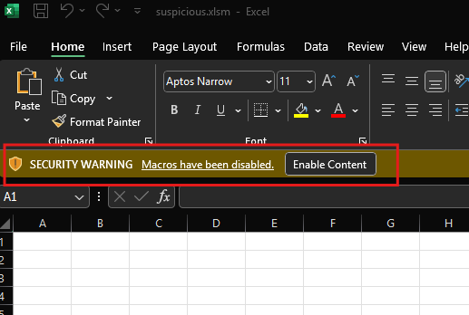
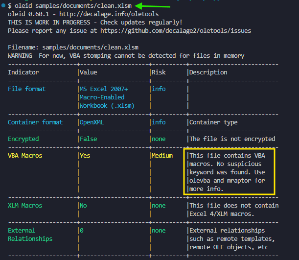
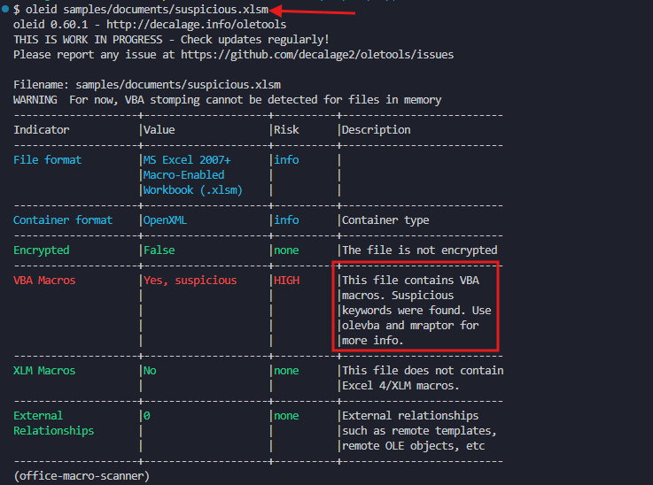

# Progress Notes

A dated log of what I built, what I learned

## Sun 25 Oct 2026
- Main branch is not protected.

### **1. Created malicious looking VBA**
- Created [suspicious.xlsm](../../samples/documents/suspicious.xlsm) and added suspicious looking vba code. But never opens notepad.exe. Closed xlsm file and reopend.
- 

### **2.Tested that .xlsm is a zip file.** 
- `py scripts/inspect_ooxml.py samples/documents/clean.xlsm `

| Extension | Meaning |
|---|---|
| `.docx` / `.docm` | Word document, x refers to XML-based format/ Word document with macros |
| `.xlsx` / `.xlsm` | Excel workbook / Excel workbook with macros |
| `.pptx` / `.pptm` | PowerPoint presentation / PowerPoint presentation with macros |

### **3. Hash the files and tested**
- Original Version : `py scripts/hash_files.py samples/documents/clean.xlsm`

```
samples\documents\clean.xlsm
  MD5     18DF4B9BED807028B246FEAC19FE9C73
  SHA1    347836B0767E2CDE193A510E28BBFED702D9DF68
  SHA256  ACA07589C8399186D364330575E8C8D1062A776E10DAF156909496BE58B7BF28
```

- MOdified Version : `py scripts/hash_files.py samples/documents/change_documents/clean.xlsm`

```
samples\documents\change_documents\clean.xlsm
  MD5     722073CB881747EA66607031D87E1BCA
  SHA1    0B3C8310A084AF457B323181FC5243D12B934829
  SHA256  5F4E8FE959B8BE42043AE33BF9CC02A23731D41731ABE5BAC17147E0CC848669
```

### **4. [oletools](https://github.com/decalage2/oletools)**

```
uv pip install oletools

# oleid: to analyze OLE files to detect specific characteristics usually found in malicious files.
```
#### 4.1. Check what kinf of file, does it have macro? Is it encrypted?

- oleid clean file `oleid samples/documents/clean.xlsm`

- 

- oleid suspicious file (nodepad.xex and some obusfaced text)

- 

#### 4.2. List the streams inside vbaProject.bin

- oledir: to display all the directory entries of an OLE file, including free and orphaned entries.
- `pwsh .\scripts\inspect_vbaproject.ps1 samples\documents\suspicious.xlsm`
- vbaProject.bin has VBA code written.

```
oledir 0.54 - http://decalage.info/python/oletools
OLE directory entries in file 
...Local\Temp\macro-look\suspicious\extracted\xl\vbaProject.bin:
----+------+-------+----------------------+-----+-----+-----+--------+------
id  |Status|Type   |Name                  |Left |Right|Child|1st Sect|Size  
----+------+-------+----------------------+-----+-----+-----+--------+------
0   |<Used>|Root   |Root Entry            |-    |-    |8    |3       |9472  
1   |<Used>|Storage|VBA                   |-    |-    |3    |0       |0     
2   |<Used>|Stream |ModLooksBad_OpenNotepa|5    |-    |-    |0       |3234  
    |      |       |d                     |     |     |     |        |      
3   |<Used>|Stream |ThisWorkbook          |4    |2    |-    |33      |999   
4   |<Used>|Stream |Sheet1                |6    |-    |-    |43      |991   
5   |<Used>|Stream |_VBA_PROJECT          |-    |-    |-    |53      |2795  
6   |<Used>|Stream |dir                   |-    |-    |-    |7F      |612   
7   |<Used>|Stream |PROJECTwm             |-    |-    |-    |89      |134   
8   |<Used>|Stream |PROJECT               |1    |7    |-    |8C      |505   
9   |unused|Empty  |                      |-    |-    |-    |0       |0     
10  |unused|Empty  |                      |-    |-    |-    |0       |0     
11  |unused|Empty  |                      |-    |-    |-    |0       |0     
----+----------------------------+------+--------------------------------------
id  |Name                        |Size  |CLSID                                 
----+----------------------------+------+--------------------------------------
0   |Root Entry                  |-     |                                      
8   |PROJECT                     |505   |                                      
7   |PROJECTwm                   |134   |                                      
1   |VBA                         |-     |                                      
2   |  ModLooksBad_OpenNotepad   |3234  |                                      
4   |  Sheet1                    |991   |                                      
3   |  ThisWorkbook              |999   |                                      
5   |  _VBA_PROJECT              |2795  |                                      
6   |  dir                       |612   |     
```

#### 4.3 Extract the code

- olevba: to extract and analyze VBA Macro source code from MS Office documents (OLE and OpenXML).

- `py .\scripts_experiments\run_olevba.py samples\documents `
- OUTPUT : D:\repos\office-macro-scanner\output
- Usage and options
  - https://github.com/decalage2/oletools/wiki/olevba
