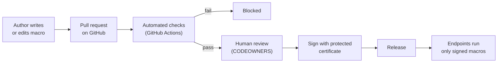
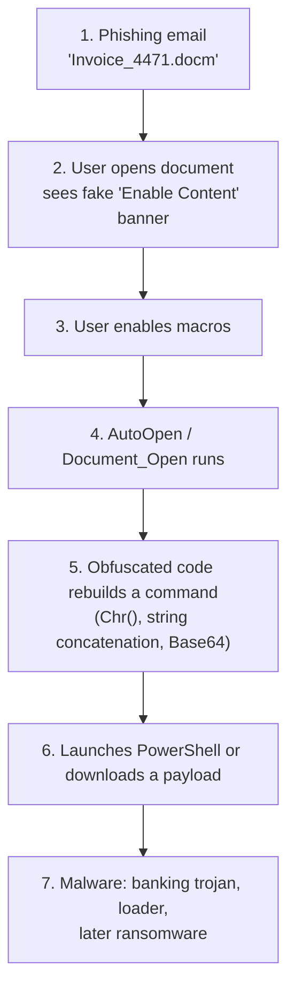

# Study Notes: Office Macro Security Pipeline

These notes assume no prior knowledge of Office macros, Git, GitHub, or CI/CD. Each part builds on the previous one, and Part 8 connects everything back to the project.

> Facts, dates and CVE numbers here are a starting point. Before quoting them publicly, confirm them against the primary source (Microsoft Security Response Center, NVD, MITRE ATT&CK, vendor reports).

## Contents

- [The big picture in one page](#the-big-picture-in-one-page)
- [Part 1. Why macros matter for cyber security](#part-1-why-macros-matter-for-cyber-security)
- [Part 2. Office files and macros under the hood](#part-2-office-files-and-macros-under-the-hood)
- [Part 3. Git and GitHub](#part-3-git-and-github)
- [Part 4. CI/CD and GitHub Actions](#part-4-cicd-and-github-actions)
- [Part 5. Analysing macros: static, emulation and dynamic](#part-5-analysing-macros-static-emulation-and-dynamic)
- [Part 6. Code signing and trust](#part-6-code-signing-and-trust)
- [Part 7. Governance and security frameworks](#part-7-governance-and-security-frameworks)
- [Part 8. Connecting the dots](#part-8-connecting-the-dots)
- [Part 9. Glossary](#part-9-glossary)
- [Part 10. Self-check questions](#part-10-self-check-questions)
- [Part 11. Further reading](#part-11-further-reading)

---

## The big picture in one page

**Problem:** Office macros are small programs inside Word and Excel files. Businesses depend on them, and attackers have used them for decades to break into organisations. You cannot simply ban them, so you need a safe way to allow the good ones.

**Idea:** Treat macros like any other software. Keep their source code in Git, check every change automatically, have a human approve it, and only then sign it with a certificate that company computers trust. Computers are configured to run **only** signed macros, so anything that skipped the process cannot run.



Keep this picture in mind. Every part below explains one box or arrow.

---

## Part 1. Why macros matter for cyber security

### 1.1 What a macro is

A **macro** is a program stored inside an Office document that automates work: formatting a report, pulling data from a database, generating invoices.

- Most macros are written in **VBA (Visual Basic for Applications)**, a programming language built into Word, Excel, PowerPoint, Access and Outlook.
- Excel also supports an older macro language, **XLM (Excel 4.0 macros)**, written as formulas in special "macro sheets".
- Files that may contain macros use extensions like `.docm`, `.xlsm`, `.pptm`, `.dotm` (template), `.xlam` (add-in), and the legacy `.doc`, `.xls`, `.ppt`.

A tiny VBA example:

```vb
Sub Greet()
    MsgBox "Hello from a macro"
End Sub
```

### 1.2 Why attackers love macros

VBA is not a toy. A macro runs with the same permissions as the user who opened the document and can:

- Run programs (`Shell`, `WScript.Shell`), including PowerShell and `cmd.exe`.
- Download files from the internet (`URLDownloadToFile`, `MSXML2.XMLHTTP`).
- Read, write and delete files (`Scripting.FileSystemObject`).
- Call any Windows API directly (`Declare PtrSafe Function VirtualAlloc ...`), which lets it inject code into memory.
- Run automatically when the document opens (`AutoOpen`, `Document_Open`, `Workbook_Open`).

Add **social engineering** ("This invoice is protected. Click *Enable Content* to view it.") and email delivery, and you have a cheap, reliable way into almost any organisation.

| Why it works for attackers | Explanation |
| :--- | :--- |
| Everyone has Office | Huge target base; files look normal in email. |
| It is a feature, not a bug | No exploit needed; the user just clicks *Enable Content*. |
| Full Windows access | Same power as any program the user runs. |
| Easy to disguise | Code can be obfuscated, hidden in forms, cells or document properties. |
| Hard to ban | Finance, engineering and operations teams rely on legitimate macros. |

### 1.3 Anatomy of a typical macro attack



The macro is usually only the **first stage** (a "dropper" or "downloader"). Its job is to fetch the real malware. Many large ransomware incidents started with exactly this chain.

### 1.4 History and notable campaigns

| Year | Event | Why it matters |
| :--- | :--- | :--- |
| 1995 | **Concept** virus | Widely cited as the first Word macro virus seen in the wild. Spread by infecting the Normal template. |
| 1999 | **Melissa** | Word macro that mass-mailed itself through Outlook; overwhelmed email systems worldwide. |
| 2000s | Microsoft disables macros by default and adds the security warning bar | Attackers respond by tricking users into clicking *Enable Content*. |
| ~2014–2021 | **Dridex, Emotet, TrickBot, Qakbot (QBot), IcedID** | Banking trojans and loaders delivered mostly via macro documents; often led to ransomware (e.g. Ryuk, Conti). |
| 2020–2021 | Surge in **Excel 4.0 (XLM)** macro abuse | Old macro language, poorly inspected by security tools at the time. |
| Jan 2021 | International law-enforcement takedown of Emotet infrastructure | Emotet returned later in 2021, showing how resilient the model was. |
| 2021–2022 | Microsoft disables XLM macros by default | Closes a heavily abused path. |
| 2022 | Microsoft blocks VBA macros in files from the internet by default (Mark of the Web) | A major change; macro-based attacks fell sharply. |
| 2022–2023 | Attackers shift to ISO/IMG/ZIP containers, LNK shortcuts, OneNote files, HTML smuggling | Mostly to bypass Mark of the Web. Macros remain a risk inside organisations and for internally shared files. |

**Lesson:** Defaults improved, but macros did not go away. Internal and shared documents, add-ins, templates, and files whose internet marker was removed can still run macros. Organisations that use macros need governance.

### 1.5 CVEs: vulnerabilities versus feature abuse

A **CVE (Common Vulnerabilities and Exposures)** is a public ID for a specific software bug, e.g. `CVE-2022-30190`.

Important distinction:

- **Macro attacks are usually feature abuse, not CVEs.** VBA doing dangerous things is working as designed; the user allowed it.
- **Document exploits are CVEs.** They trigger a bug in Office or Windows, often with *no macro and no click on Enable Content*.

Your pipeline mainly addresses feature abuse. Document exploits are covered by patching, but some analysis tools in this project (e.g. `oletools`' `rtfobj`, `oleobj`, `msodde`) also help spot them.

| CVE | Name / component | What happened | Macro needed? |
| :--- | :--- | :--- | :--- |
| CVE-2017-0199 | Office / WordPad OLE2Link | Document fetched and ran a remote HTA script. Widely exploited in 2017. | No |
| CVE-2017-11882 | Equation Editor (`EQNEDT32.EXE`) | Memory corruption in a legacy component; Microsoft later removed Equation Editor. Exploited for years. | No |
| CVE-2021-40444 | MSHTML (via Office documents) | Malicious ActiveX control loaded through a crafted document. | No |
| CVE-2022-30190 | "Follina", MSDT | Word document invoked the Microsoft Support Diagnostic Tool to run code. | No |
| CVE-2023-36884 | Office and Windows HTML | Remote code execution via crafted Office documents; used in targeted attacks. | No |
| CVE-2022-41091 | Windows Mark of the Web bypass | Files extracted from crafted ZIPs lost the internet marker, weakening macro blocking. | Enables macro attacks |

Takeaway: macro governance is one control among several. Patching, Protected View and Mark of the Web handle the exploit side.

### 1.6 Mapping to MITRE ATT&CK

**MITRE ATT&CK** is a public catalogue of attacker techniques. Security teams use its IDs as a shared vocabulary.

| Technique ID | Name | Macro connection |
| :--- | :--- | :--- |
| T1566.001 | Phishing: Spearphishing Attachment | Delivering the macro document by email. |
| T1204.002 | User Execution: Malicious File | User opens the file and enables content. |
| T1059.005 | Command and Scripting Interpreter: Visual Basic | VBA itself as the execution engine. |
| T1137.001 | Office Application Startup: Office Template Macros | Persistence via macros in `Normal.dotm` or templates. |
| T1221 | Template Injection | Document loads a remote template that contains macros. |
| T1564.007 | Hide Artifacts: VBA Stomping | Source code hidden or replaced while compiled code still runs (see 2.3). |
| T1553.005 | Subvert Trust Controls: Mark-of-the-Web Bypass | Removing the "came from the internet" marker. |

### 1.7 The defender's dilemma

- Blocking all macros breaks legitimate business processes.
- Allowing all macros invites attacks.
- **Middle path:** allow only macros that are *known, reviewed, and signed by your organisation*. This is the control most frameworks recommend (Part 7), and it is exactly what this project automates.

---

## Part 2. Office files and macros under the hood

### 2.1 Two file formats

| Format | Extensions | Structure |
| :--- | :--- | :--- |
| Legacy binary | `.doc`, `.xls`, `.ppt` | **OLE / Compound File Binary (CFB)**: a mini file system inside one file, with "storages" (folders) and "streams" (files). |
| Office Open XML (OOXML) | `.docx`, `.xlsx`, `.docm`, `.xlsm`, `.dotm` | A **ZIP archive** of XML files. |

You can rename an `.xlsm` to `.zip` and open it. Inside you will find something like:

```text
[Content_Types].xml
xl/workbook.xml
xl/worksheets/sheet1.xml
xl/vbaProject.bin      <- the macros live here
xl/_rels/...
```

- `.docx` / `.xlsx` **cannot** contain VBA. The `m` in `.docm` / `.xlsm` means "macro-enabled".
- `vbaProject.bin` is itself an **OLE/CFB** file, so even modern documents store macros in the old binary format.

### 2.2 Why Git cannot review macros directly

Git compares text files line by line. `vbaProject.bin` is binary and compressed, so a pull request just shows "binary file changed". A reviewer cannot see that someone added `Shell "powershell ..."`.

**Solution in this project:** extract the VBA source into plain text files (`.bas` for modules, `.cls` for classes, `.frm` for forms) and review those instead.

### 2.3 Source code, p-code and VBA stomping

Inside `vbaProject.bin`, each module can be stored in up to two forms:

1. **Compressed source code**: the text you wrote.
2. **P-code**: a compiled, version-specific form Office can run directly.

If the Office version matches, Office may run the **p-code and ignore the source**. Attackers abuse this with **VBA stomping**: they replace the source with harmless text while keeping malicious p-code. A tool that reads only the source sees nothing bad.

Implications for the pipeline:

- Do not trust the extracted source blindly. Check for mismatches between source and p-code (`olevba` can flag stomping; `pcodedmp` decompiles p-code).
- Better still: **build the document from reviewed source** at release time, so whatever runs is exactly what was reviewed (spec section "Build on release").

Related trick: **VBA purging** removes p-code so only source remains (used defensively and offensively).

### 2.4 Excel 4.0 (XLM) macros

- Written as formulas in hidden "macro sheets", e.g. `=EXEC("calc.exe")`.
- Not stored in `vbaProject.bin`, so VBA-only tools miss them.
- Often heavily obfuscated with formulas that build other formulas.
- Tool: **XLMMacroDeobfuscator** emulates them to reveal what they do.

### 2.5 Auto-execution triggers

Code that runs without the user pressing a button:

| Application | Trigger names |
| :--- | :--- |
| Word | `AutoOpen`, `Document_Open`, `AutoClose`, `Document_Close`, `AutoExec`, `AutoNew` |
| Excel | `Auto_Open`, `Workbook_Open`, `Workbook_Activate`, `Auto_Close` |
| Any (ActiveX controls) | Events like `InkPicture1_Painted`, `Frame1_Layout` that fire on load |

An auto-exec trigger plus a dangerous capability is the classic malicious combination. `mraptor` (Part 5) uses exactly this logic.

### 2.6 Dangerous capabilities to recognise

| Category | Examples |
| :--- | :--- |
| Run programs | `Shell`, `WScript.Shell`, `Run`, `Exec`, `ShellExecute`, `MacScript` |
| Download | `URLDownloadToFile`, `MSXML2.XMLHTTP`, `WinHttp.WinHttpRequest`, `InternetExplorer.Application` |
| Files | `Scripting.FileSystemObject`, `Open ... For Binary`, `Kill`, `SaveToFile` (ADODB.Stream) |
| Windows API | `Declare PtrSafe Function`, `VirtualAlloc`, `RtlMoveMemory`, `CreateThread` |
| COM / WMI | `CreateObject`, `GetObject("winmgmts:")`, `Win32_Process` |
| Persistence | Writing to `Normal.dotm`, registry Run keys, scheduled tasks |

Legitimate macros sometimes use these too (e.g. a reporting tool that writes files). That is why the pipeline has **human review and justified exceptions**, not just automated blocking.

### 2.7 Obfuscation techniques

Attackers hide intent so string-matching tools miss it:

- `Chr(80) & Chr(111) & Chr(119)...` builds "Pow..." character by character.
- String splitting and concatenation: `"pow" & "er" & "shell"`.
- `StrReverse("llehsrewop")`.
- Base64 or hex encoded payloads.
- `Environ("TEMP")` and other runtime values, so the final command only exists while running.
- Payloads hidden in cell values, document properties, form captions, or comments.
- Junk code and random variable names.

Static tools spot *signs* of obfuscation. **Emulation** (Part 5) actually resolves it.

### 2.8 How Office decides whether a macro runs

| Control | What it does |
| :--- | :--- |
| **Trust Center macro settings** | Options include: disable without notification, disable with notification, **disable all except digitally signed macros**, enable all. |
| **Mark of the Web (MOTW)** | Windows tags files downloaded from the internet. Office now blocks macros in such files by default. |
| **Protected View** | Opens internet files read-only in a sandbox. |
| **Trusted Locations** | Folders whose files run macros without prompts. Dangerous if users can write there. |
| **Trusted Publishers** | Certificates whose signed macros are trusted. **This is what the pipeline relies on.** |
| **Group Policy / Intune** | Lets IT enforce these settings on every computer, so users cannot change them. |

The target end state of this project: endpoints are set by policy to "disable all except digitally signed macros", with only your organisation's signing certificate in Trusted Publishers.

---

## Part 3. Git and GitHub

### 3.1 Git basics

**Git** is a version control system. It records snapshots of files over time.

| Term | Meaning |
| :--- | :--- |
| Repository (repo) | A project folder tracked by Git, with its full history. |
| Commit | One saved snapshot with a message, author and timestamp. Each has a unique hash ID. |
| Branch | A separate line of work. `main` is usually the trusted, released line. |
| Merge | Combining a branch's changes into another branch. |
| Diff | The line-by-line difference between two versions. |
| Clone / push / pull | Copy a repo; send commits to the server; fetch commits from it. |

Typical flow:

```bash
git clone https://github.com/<org>/<repo>.git
git switch -c fix-invoice-macro      # new branch
# ...edit files...
git add src/Invoice/Module1.bas
git commit -m "Fix rounding in invoice totals"
git push -u origin fix-invoice-macro
```

### 3.2 GitHub features this project uses

| Feature | Role in the pipeline |
| :--- | :--- |
| **Pull request (PR)** | Proposes merging a branch into `main`. Shows the diff, runs checks, collects reviews. |
| **Status checks** | Results of automated jobs shown on the PR (pass/fail). |
| **Branch protection / rulesets** | Rules on `main`: no direct pushes, required checks must pass, required approvals. |
| **CODEOWNERS** | A file mapping paths to required reviewers, e.g. Security must approve changes to `src/`. |
| **Code scanning (SARIF)** | Shows security findings inline on the PR. |
| **Secrets and environments** | Store credentials; an environment can require manual approval before a job uses them. |
| **Releases** | Versioned downloads with attached files (the signed documents). |
| **Audit log** | Who changed what, when; supports the "immutable audit trail" goal. |

### 3.3 Why this matters for macros

Without Git: macros are edited in place on a shared drive, nobody knows who changed what, and nobody reviewed it.

With Git + GitHub: every change has an author, a reason, a reviewer, and test results, and can be rolled back.

---

## Part 4. CI/CD and GitHub Actions

### 4.1 CI and CD

- **CI (Continuous Integration):** every proposed change is automatically built and tested.
- **CD (Continuous Delivery/Deployment):** approved changes are automatically packaged and released.
- **"Shift left":** catch problems as early as possible (at the PR), when they are cheapest to fix.

In this project: **CI = analyse every PR**, **CD = sign and release after merge**.

### 4.2 GitHub Actions concepts

| Concept | Meaning |
| :--- | :--- |
| **Workflow** | An automation defined in a YAML file under `.github/workflows/`. |
| **Event (trigger)** | What starts it: `pull_request`, `push`, `release`, `workflow_dispatch` (manual), `schedule`. |
| **Job** | A group of steps that runs on one machine. Jobs can run in parallel or depend on each other. |
| **Step** | One command (`run:`) or one reusable action (`uses:`). |
| **Action** | A reusable building block, e.g. `actions/checkout` downloads your repo onto the runner. |
| **Runner** | The machine that runs the job. GitHub-hosted (`ubuntu-latest`, `windows-latest`) or self-hosted (your own). |
| **Secrets** | Encrypted values (tokens, IDs) passed to workflows. |
| **Environment** | A named deployment target (e.g. `signing`) with its own secrets and protection rules such as required approvers. |
| **Artifact** | Files saved from a run for download (e.g. extracted source, reports). |
| **Permissions** | What the workflow's built-in `GITHUB_TOKEN` may do. Set them to the minimum. |

### 4.3 Anatomy of a workflow file

```yaml
name: macro-ci                      # display name
on:
  pull_request:                     # run on every PR...
    paths: ["documents/**", "src/**"]   # ...that touches these paths
permissions:
  contents: read                    # least privilege
jobs:
  analyse:                          # job id
    runs-on: ubuntu-latest          # GitHub-hosted Linux runner
    steps:
      - uses: actions/checkout@v4   # get the repo
      - uses: actions/setup-python@v5
        with:
          python-version: "3.12"
      - run: pip install oletools   # install tools
      - run: olevba --json documents/*.xlsm   # analyse
```

When the last command exits non-zero, the job fails, the PR shows a red X, and branch protection blocks the merge.

### 4.4 Runners and why Office is a problem

- GitHub-hosted runners are fresh virtual machines, destroyed after each job. They **do not include Microsoft Office**, and Office licensing and GUI automation make installing it there impractical.
- Therefore the design uses **headless** tools that understand Office files without Office (oletools, emulators), and an **optional** isolated Windows VM or sandbox service for real execution.
- **Never detonate suspicious documents on a normal CI runner.** Use an isolated sandbox.

### 4.5 Secrets, OIDC and least privilege

- Storing long-lived passwords as secrets is risky: anyone who can modify the workflow might leak them.
- **OIDC (OpenID Connect) federation** lets a workflow prove its identity to a cloud provider (e.g. Azure) and receive a short-lived token, with no stored password. This project uses it to reach Azure Key Vault for signing.
- Combine with an **environment** that requires approval and only allows the `main` branch, so a PR from a random branch can never reach the signing key.

### 4.6 Workflow security pitfalls

| Pitfall | Safer practice |
| :--- | :--- |
| `pull_request_target` running untrusted PR code with secrets | Use `pull_request` for analysis; secrets are not exposed to forks. |
| Third-party actions pinned to a moving tag | Pin to a full commit SHA for sensitive workflows. |
| Broad `GITHUB_TOKEN` permissions | Set `permissions:` explicitly per workflow/job. |
| Untrusted input in shell commands (`${{ github.event.pull_request.title }}`) | Pass via environment variables; never interpolate directly into `run:`. |
| Signing in the PR workflow | Sign only in the post-merge workflow behind a protected environment. |

### 4.7 SARIF

**SARIF (Static Analysis Results Interchange Format)** is a standard JSON format for findings. Uploading a SARIF file to GitHub shows each finding as an annotation in the PR and in the Security tab. The spec's "Attach SARIF / Report to PR" step refers to this.

---

## Part 5. Analysing macros: static, emulation and dynamic

### 5.1 Three ways to analyse

| Approach | How | Strengths | Weaknesses |
| :--- | :--- | :--- | :--- |
| **Static** | Read the code without running it. | Fast, safe, cheap; runs on any runner. | Misses obfuscated or runtime-built behaviour. |
| **Emulation** ("somewhat dynamic") | Simulate execution in a tool that understands VBA/XLM. | Resolves obfuscation safely; no Office needed. | Emulators are incomplete; complex code may break them. |
| **Dynamic (detonation)** | Actually open the document in Office inside an isolated VM and watch it. | Sees real behaviour. | Slow, costly, needs isolation; malware may detect sandboxes. |

The pipeline layers all three (defence in depth): static on every PR, emulation on every PR, detonation optional.

### 5.2 oletools

A Python toolkit by Philippe Lagadec for analysing Office files. Key tools:

| Tool | What it does |
| :--- | :--- |
| `olevba` | Extracts VBA source; flags auto-exec triggers, suspicious keywords, IOCs (URLs, IPs), encoded strings; can detect VBA stomping. |
| `mraptor` | "Macro Raptor": flags a document as suspicious if it has **auto-exec + (write or execute)** capability. Simple, effective triage. |
| `msodde` | Detects DDE links (another way to run commands without macros). |
| `oleid` | Quick overview of risky features in a file. |
| `oleobj` / `rtfobj` | Extract embedded objects, useful for exploit documents. |
| `olemeta`, `oledir` | Metadata and internal structure. |

Example:

```bash
olevba --decode suspicious.xlsm     # show code and decode encoded strings
mraptor suspicious.xlsm             # quick verdict
```

### 5.3 YARA

**YARA** is a pattern-matching language used across the security industry. You write rules describing what to look for; YARA reports which files match.

```yara
rule Macro_Downloads_File
{
    meta:
        description = "VBA that downloads a file"
        severity = "high"
    strings:
        $a = "URLDownloadToFile" nocase
        $b = "MSXML2.XMLHTTP" nocase
        $c = "WinHttp.WinHttpRequest" nocase
    condition:
        any of them
}
```

In this project YARA enforces **your organisation's policy**: e.g. "no macro may declare Win32 APIs" or "no macro may contact the internet", even when that is not strictly malicious.

### 5.4 Secret scanning and linting

- **Secret scanning** (`gitleaks`, GitHub Secret Scanning): finds passwords, API keys, connection strings, and internal paths accidentally left in code.
- **Linting** (Rubberduck VBA, custom regex): enforces good practice like `Option Explicit` (forces variable declaration) and proper error handling. Quality issues are not attacks, but clean code is easier to review.

### 5.5 Emulators

- **ViperMonkey**: parses and emulates VBA; reveals the commands an obfuscated macro would build. Check its maintenance status before relying on it; it may need a Docker image to run.
- **XLMMacroDeobfuscator**: emulates Excel 4.0 macro formulas.

### 5.6 Sandboxes

- **CAPE Sandbox** and **Cuckoo** (self-hosted, open source), **Tria.ge**, **Joe Sandbox**, **ANY.RUN** (hosted services).
- You submit a file through an API; the sandbox opens it in a monitored VM and returns a report: processes started, network connections, files written.
- **Sysmon** and **ETW** are Windows logging technologies used to capture that behaviour on your own VMs.
- Careful: uploading internal documents to a **public** sandbox can leak confidential data. Use private or self-hosted options for business documents.

### 5.7 False positives and exceptions

A finance macro may legitimately write a CSV file. The pipeline should:

1. Flag it.
2. Let the author explain it in the PR.
3. Let a designated reviewer approve a documented exception (e.g. an allow-list entry with an owner and expiry date).

Without an exception process, people work around the pipeline.

---

## Part 6. Code signing and trust

### 6.1 Building blocks

| Concept | Meaning |
| :--- | :--- |
| **Hash** (e.g. SHA-256) | A fingerprint of data. Any change produces a different hash. |
| **Public/private key pair** | Data signed with the private key can be verified by anyone with the public key. |
| **Digital signature** | A hash of the content, encrypted with the private key. Proves *who* signed and that the content has *not changed since*. |
| **Certificate** | A public key plus identity information, issued by a Certificate Authority (CA). |
| **Certificate Authority** | Trusted issuer. Can be a public CA (DigiCert, Sectigo) or your organisation's internal CA. |
| **Code-signing certificate** | A certificate allowed to sign code. |
| **Timestamping** | A trusted third party records *when* you signed, so signatures stay valid after the certificate expires. |
| **HSM / Key Vault** | Hardware or cloud service that holds private keys so they can be used but never copied out. |

### 6.2 Signing a VBA project

- Office signs the **VBA project** (the macros), not the whole document. Editing a cell does not break the signature; editing the code does.
- Modern Office uses newer signature formats than older versions; tools must produce the right one. Microsoft publishes **Office Subject Interface Packages (SIPs)** that let Windows `signtool.exe` sign and verify VBA projects. Plain `signtool` without the SIP does not sign VBA projects.
- Manual alternative: Office's VBA editor (Tools → Digital Signature). Fine for learning; not for an automated pipeline.

### 6.3 Trust on the endpoint

1. IT deploys your organisation's code-signing certificate to every computer's **Trusted Publishers** store (via Group Policy or Intune).
2. Office macro setting is enforced: **"Disable all macros except digitally signed macros"**.
3. Result: only macros signed with your key run. A macro modified after signing fails verification and is blocked.

### 6.4 What signing proves and what it does not

- **Proves:** the code came from the holder of the key and has not changed since signing.
- **Does not prove:** the code is safe. A signed malicious macro is still malicious.

That is why **signing must happen only after analysis and review**, and why the key must be protected. If an attacker can get the pipeline to sign their code, every endpoint will trust it. The signing key is the most valuable asset in the whole system.

---

## Part 7. Governance and security frameworks

**Governance** means rules, roles and evidence: who may change macros, who approves, what is checked, and the records that prove it happened.

Frameworks give a recognised checklist. The project maps to several so it is useful in many countries:

| Framework | Origin | What it covers | Relevance |
| :--- | :--- | :--- | :--- |
| **NIST SSDF (SP 800-218)** | USA, used internationally | Secure software development practices | Review, protected signing keys, release integrity. |
| **CIS Controls v8** | International non-profit | Prioritised security safeguards | Safeguard 2.7 "Allowlist authorised scripts" covers macros. |
| **CIS Microsoft Office Benchmarks** | International non-profit | Exact configuration settings | The Group Policy settings for macro trust. |
| **NIST SP 800-53** | USA | Comprehensive control catalogue | Configuration management, malware protection, integrity. |
| **ISO/IEC 27001:2022** | International standard | Information security management | Annex A controls for malware, secure development, change management, cryptography. |
| **ASD Essential Eight** | Australia | Eight mitigation strategies | "Configure Microsoft Office macro settings" at Maturity Levels 1–3. |
| **NCSC guidance** | UK | Practical advice | Macro security guidance. |
| **SLSA** | Open Source Security Foundation | Build integrity and provenance | Tamper-evident releases. |

Key governance principles in this project:

- **Separation of duties:** the author cannot approve their own change, and no human holds the signing key.
- **Least privilege:** each workflow and person gets only the access needed.
- **Evidence:** PR history, check results, approvals, release hashes and logs form an audit trail.

The full mapping is in the spec's *Security Framework Alignment* section.

---

## Part 8. Connecting the dots

### 8.1 One macro's journey

1. **Author** edits `Invoice.xlsm` in Excel, adding a button that exports a CSV.
2. Locally, a **pre-commit hook** runs `olevba` to extract `src/Invoice/Module1.bas`. Both the document and the text source are committed.
3. Author pushes a branch and opens a **pull request**.
4. **GitHub Actions CI** starts on a fresh Ubuntu runner:
   - Re-extracts the source and checks it matches what was committed (catches a tampered binary or **VBA stomping**).
   - `olevba` and `mraptor` report: no auto-exec, but `Open ... For Output` (file write).
   - **YARA** policy rules: no internet access, no Win32 API. Pass.
   - **gitleaks**: no secrets. Pass.
   - **Emulation**: nothing hidden.
   - Results upload as **SARIF**; the file-write finding shows as a warning on the PR.
5. **Human review:** a CODEOWNER from Finance Engineering reads the readable `.bas` diff, sees the CSV export is intended, and approves. **Branch protection** now allows the merge.
6. **CD workflow** on `main`: runs in the protected `signing` **environment**, logs in to Azure with **OIDC**, signs the VBA project with the key in **Key Vault**, verifies the signature, computes **SHA-256**, and publishes a **GitHub Release**.
7. **IT** distributes the signed file. Endpoints, configured to run only macros from the **Trusted Publisher**, run it. An attacker's copy with modified code fails the signature check and is blocked.

### 8.2 Threat-to-control map

| Threat | Stage that stops it |
| :--- | :--- |
| Malicious macro from a phishing email | Endpoint policy: unsigned, so it never runs. |
| Insider adds malicious code | Static analysis, emulation, and human review before signing. |
| Obfuscated payload | Emulation and sandbox resolve it; obfuscation patterns flagged statically. |
| VBA stomping (source and p-code differ) | Source/binary consistency check; build from source at release. |
| Hardcoded credentials | Secret scanning. |
| Attacker tries to sign their own code | Key never leaves Key Vault; only the `main` workflow in a protected environment can use it. |
| Signed file altered later | Signature verification fails on endpoint. |
| "Who approved this?" during an incident | Git history, PR approvals, release hashes and logs. |

### 8.3 How the spec stages map to these notes

| Spec stage | Notes |
| :--- | :--- |
| 1. Unpack & Normalise | Parts 2.1–2.3 |
| 2. Static Analysis | Parts 2.5–2.7, 5.2–5.4 |
| 3. Somewhat Dynamic Analysis | Parts 5.5–5.6 |
| 4. Peer Review (PR Gate) | Parts 3.2, 5.7 |
| 5. Signing & Release | Part 6, Part 4.5 |
| Framework alignment | Part 7 |

---

## Part 9. Glossary

| Term | Definition |
| :--- | :--- |
| ActiveX | Legacy Windows component technology; controls in documents can fire events that run code. |
| Artifact (GitHub) | File saved from a workflow run. |
| Auto-exec | Macro that runs automatically on open/close. |
| Branch protection | GitHub rules that guard a branch such as `main`. |
| CFB / OLE | Compound File Binary, the "file system in a file" used by legacy Office and `vbaProject.bin`. |
| CI/CD | Continuous Integration / Continuous Delivery. |
| CODEOWNERS | GitHub file that assigns required reviewers by path. |
| CVE | Public identifier for a specific vulnerability. |
| DDE | Dynamic Data Exchange; legacy feature abusable to run commands from documents. |
| Detonation | Running a suspicious file in a sandbox to observe it. |
| Emulation | Simulating code execution without the real runtime. |
| ETW | Event Tracing for Windows, a logging framework. |
| HSM | Hardware Security Module, protects private keys. |
| IOC | Indicator of Compromise (URL, IP, hash linked to an attack). |
| Key Vault | Azure's managed service for keys, secrets and certificates. |
| MOTW | Mark of the Web; Windows marker for files from the internet. |
| OIDC | OpenID Connect; lets workflows get short-lived cloud tokens without stored passwords. |
| OOXML | Office Open XML, the ZIP-based modern Office format. |
| P-code | Compiled form of VBA stored alongside source. |
| Pull request | Proposal to merge changes, with review and checks. |
| Runner | Machine that executes GitHub Actions jobs. |
| SARIF | Standard JSON format for static analysis results. |
| SHA-256 | Widely used cryptographic hash function. |
| SIP | Subject Interface Package; plug-in that teaches Windows signing tools a file format. |
| Sysmon | Microsoft Sysinternals tool that logs detailed process/network activity. |
| Trusted Publisher | Certificate whose signed code a computer trusts. |
| VBA | Visual Basic for Applications, the main Office macro language. |
| VBA stomping | Hiding malicious p-code behind benign or missing source. |
| XLM | Excel 4.0 macro language. |
| YARA | Pattern-matching rule language for files. |

---

## Part 10. Self-check questions

1. Why is "Enable Content" the most important click in a macro attack?
2. What is the difference between a `.xlsx` and a `.xlsm`? Where are the macros stored?
3. Why can't a reviewer see macro changes in a normal Git diff?
4. Explain VBA stomping and one pipeline step that defends against it.
5. Which Word and Excel event names run code automatically?
6. What does `mraptor` look for, in one sentence?
7. Why are Follina (CVE-2022-30190) and CVE-2017-11882 not stopped by "signed macros only"?
8. What is the difference between static analysis, emulation, and detonation?
9. Why should suspicious documents never be opened on a normal CI runner?
10. What does a digital signature prove, and what does it not prove?
11. Why must signing happen only after review, and only in the post-merge workflow?
12. How does OIDC reduce risk compared with storing a password as a GitHub secret?
13. What Office setting makes the whole pipeline effective on endpoints?
14. Name two frameworks that require controlling which scripts or macros can run.

---

## Part 11. Further reading

- oletools: <https://github.com/decalage2/oletools>
- ViperMonkey: <https://github.com/decalage2/ViperMonkey>
- XLMMacroDeobfuscator: <https://github.com/DissectMalware/XLMMacroDeobfuscator>
- pcodedmp (p-code disassembler): <https://github.com/bontchev/pcodedmp>
- YARA: <https://github.com/VirusTotal/yara> and documentation at <https://yara.readthedocs.io>
- gitleaks: <https://github.com/gitleaks/gitleaks>
- Rubberduck VBA: <https://rubberduckvba.com>
- GitHub Actions documentation: <https://docs.github.com/actions>
- MITRE ATT&CK, Spearphishing Attachment: <https://attack.mitre.org/techniques/T1566/001/>
- NIST SSDF (SP 800-218): <https://csrc.nist.gov/pubs/sp/800/218/final>
- SLSA: <https://slsa.dev>
- CIS Controls: <https://www.cisecurity.org/controls>
- ASD Essential Eight: <https://www.cyber.gov.au>
- Microsoft Learn: search "Macros from the internet are blocked by default in Office" and "Office VBA digital signatures".
